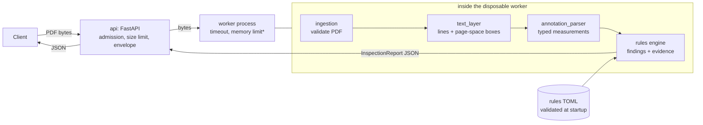

# BlueprintIQ

**Engineering drawing intelligence.** BlueprintIQ reads labeled annotations (`THICKNESS: 4 mm`, `MATERIAL: SS400`, …) from 2D vector engineering drawings in PDF form, checks them against configurable inspection rules, and returns findings that point back to the exact place on the drawing where each value was read.

> **Assistive prototype, not certified compliance software.** BlueprintIQ does not guarantee engineering safety, regulatory compliance, or manufacturing correctness. The rule thresholds shipped here are **demonstration values**, not industry or company standards. Findings must be reviewed by a qualified person.

> **Status:** Phase 1 backend MVP. It is verified against **synthetic fixtures only**; real industrial CAD PDFs have not been tested. The API is for **trusted local use**; public deployment is blocked (see [Security](docs/security-and-deployment.md)). The repository is private and unlicensed.

## What it does

```
PDF drawing ─▶ validated text lines with page-space boxes ─▶ typed measurements ─▶ rule findings with evidence
```

* **Deterministic.** No AI model is involved. Every value, comparison and explanation is reproducible.
* **Honest about uncertainty.** An annotation the parser cannot read with certainty (`THICKNESS: 4` with no unit, `2,5 mm`, `100 ± 0.5 mm`, `4 M`) is kept as **ambiguous** and can only ever produce **`needs_review`**, never a confirmed pass or fail. A missing annotation is **`missing`**, which is different from a known violation.
* **Traceable.** Each finding cites the measurements it used; each measurement carries its raw text, page number and bounding box.
* **Exact.** All numbers are `Decimal`. Unit conversion (mm, cm, m, in) is exact; JSON carries numbers as strings.

## Quick start

Requirements: Python 3.12+, [uv](https://docs.astral.sh/uv/).

```bash
cd backend
uv sync --locked                 # reproducible environment from uv.lock
uv run pytest                    # 1132 tests
uv run uvicorn blueprintiq.api.app:create_app --factory --port 8000
```

Interactive API docs: <http://127.0.0.1:8000/docs>

### Demonstration

Upload a synthetic drawing (from the `backend/` directory, with the server running):

```bash
curl -s http://127.0.0.1:8000/healthz
# {"status":"ok"}

curl -s -X POST http://127.0.0.1:8000/api/v1/inspections \
  -H "Content-Type: application/pdf" \
  -H "X-Filename: violations.pdf" \
  --data-binary @tests/fixtures/drawings/violations.pdf
```

The response is an `InspectionReport`. An excerpt of the real output for `violations.pdf`:

```json
{
  "document": {"filename": "violations.pdf", "page_count": 1, "size_bytes": 1319},
  "measurements": [
    {"id": "M1", "kind": "dimension", "dimension_type": "thickness",
     "value": "2", "unit": "mm", "normalized_value_mm": "2", "status": "parsed",
     "source": {"page_number": 1, "raw_text": "THICKNESS: 2 mm",
                "bbox": {"x0": 72.0, "y0": 549.25, "x1": 159.79, "y1": 562.99}}}
  ],
  "findings": [
    {"id": "F1", "rule_id": "THK-MIN-001", "status": "fail", "severity": "error",
     "measurement_ids": ["M1"],
     "evidence": [{"measurement_id": "M1", "page_number": 1,
                   "bbox": {"x0": 72.0, "y0": 549.25, "x1": 159.79, "y1": 562.99}}],
     "expected": ">= 3 mm", "actual": "2 mm",
     "message": "Thickness 2 mm is below the configured minimum of 3 mm."}
  ],
  "summary": {"passed": 1, "failed": 3, "missing": 0, "needs_review": 0}
}
```

Try the other fixtures in `backend/tests/fixtures/drawings/`: `ambiguous.pdf` (every outcome is `needs_review`), `conflicting.pdf` (4 mm vs 6 mm thickness → `needs_review`, never a verdict), `missing_material.pdf` (`MAT-REQ-001` is `missing`), `unit_conversion.pdf` (`0.3 cm` = exactly 3 mm, a boundary pass), `rotated_90.pdf`, `cropped_rotated_90.pdf`. Refused files return a typed error, e.g. `multi_page.pdf` → `422 TOO_MANY_PAGES`.

A worked walkthrough is in [docs/walkthrough.md](docs/walkthrough.md).

## API

| Endpoint | Purpose |
|---|---|
| `GET /healthz` | Liveness only; reveals no configuration. |
| `POST /api/v1/inspections` | Body: the PDF bytes, `Content-Type: application/pdf`. Optional `X-Filename` header (percent-encoded, display only). Returns an `InspectionReport`. |

Every error is `{"error": {"code", "message", "request_id"}}` with the same id in the `X-Request-ID` header. Codes: `FILE_TOO_LARGE` (413), `UNSUPPORTED_CONTENT_TYPE` / `UNSUPPORTED_FILE_TYPE` (415), `UPLOAD_TIMEOUT` (408), `SERVER_BUSY` (503), `INTERNAL_ERROR` (500), and `422` for PDFs that are refused or exceed limits (`INVALID_PDF`, `ENCRYPTED_PDF`, `TOO_MANY_PAGES`, `NO_TEXT_LAYER`, `UNSUPPORTED_GEOMETRY`, `PARTIALLY_VISIBLE_TEXT`, `PAGE_TOO_COMPLEX`, `TOO_MANY_TEXT_LINES`, `PROCESSING_TIMEOUT`, `RESOURCE_LIMIT_EXCEEDED`, `PROCESSING_FAILED`). Full contract: [spec §17](docs/design/phase1-mvp-spec.md).

Settings (environment variables, prefix `BLUEPRINTIQ_`): `RULESET_PATH`, `MAX_UPLOAD_BYTES`, `JOB_TIMEOUT_S`, `JOB_MEMORY_LIMIT_MB`, `MAX_CONCURRENT_JOBS`, `MAX_ADMITTED_REQUESTS`, `QUEUE_TIMEOUT_S`, `UPLOAD_TIMEOUT_S`, `LOG_LEVEL`. The default ruleset is the demonstration file shipped inside the package (`backend/src/blueprintiq/rules/demo_rules.toml`); set `BLUEPRINTIQ_RULESET_PATH` to use your own.

## How the pieces fit



\* the memory limit is enforced on Linux only.

| Milestone | Module | Responsibility |
|---|---|---|
| M1 | `domain/` | Pydantic models, exact `Decimal` units, evidence geometry; the report validator rejects a confirmed outcome built on an uncertain measurement. |
| M2 | `extraction/annotation_parser.py` | Text lines → measurements; ambiguity is flagged, never guessed. |
| M3 | `ingestion/`, `extraction/text_layer.py`, `reader.py` | Safe PDF reading, visibility, coordinates, segmentation, cost limits. |
| M4 | `rules/`, `inspection.py` | TOML rules, deterministic evaluation, duplicate/conflict policy. |
| M5 | `api/` | HTTP layer, upload safety, process isolation, logging. |

Details: [docs/architecture.md](docs/architecture.md).

## Testing and evaluation

1132 automated tests (all executed and passing locally on Windows and in GitHub Actions on Linux); see [docs/testing-and-evaluation.md](docs/testing-and-evaluation.md) for what is measured, how, and what is **not** established. In short: correctness is shown on **32 synthetic fixtures** whose expected results are written independently of the code under test; there is **no benchmark on real CAD drawings**, and no accuracy percentage is claimed.

## Known limitations

* Verified on synthetic drawings only; real CAD output (embedded fonts, per-glyph positioning, hatch clips) is untested and some valid drawings will be refused or flagged ambiguous.
* Single-page, vector/text PDFs only; no scans/OCR, DWG, multi-page, text at non-right angles, `/UserUnit` scaling.
* English labels and the documented annotation grammar only; no `Ø`, tolerances, ranges or component association (rules apply per measurement type, not per feature).
* Material rules check **presence only**, never the grade.
* Rules are demonstration constraints.
* About 1.2 s per request on Windows (a fresh worker process each time).

Full list: [docs/testing-and-evaluation.md](docs/testing-and-evaluation.md#limitations) and [docs/security-and-deployment.md](docs/security-and-deployment.md).

## Security and release restrictions

**Trusted local use only. Public deployment is blocked.** No authentication, rate limiting or TLS; no memory limit on Windows; inspections are not cancelled when a client disconnects; real CAD PDFs not benchmarked; and **PyMuPDF is AGPL-3.0 / commercial**, so a licensing decision (publish under AGPL-3.0, buy a licence, or switch to a permissive engine such as pypdfium2 — see [ADR-001](docs/design/adr-001-pdf-engine.md)) is required before the repository is made public. See [docs/security-and-deployment.md](docs/security-and-deployment.md).

## Roadmap

1. **Phase 1.5 (hardening):** benchmark on real, permissioned CAD PDFs; warm worker pool; disconnect cancellation; clip-scope handling; licence decision.
2. **Phase 2 (frontend):** Next.js + PDF.js viewer with evidence overlays (page-space → PDF user space mapping is documented in spec §15.1), findings panel, report export.
3. **Phase 3 (assistive AI, optional):** vision-language interpretation for scanned/unlabeled drawings behind the same evidence and uncertainty rules; human review workflow.

## Repository layout

```
backend/src/blueprintiq/   domain, ingestion, extraction, rules (+ demo_rules.toml), api, inspection.py
backend/tests/             unit, integration, api, fixtures (PDFs + independent ground truth)
backend/scripts/           generate_fixtures.py
docs/design/               Phase 1 specification, ADR-001
docs/                      architecture, walkthrough, testing & evaluation, security
.github/workflows/         backend-ci.yml (ruff, mypy --strict, pytest)
```
