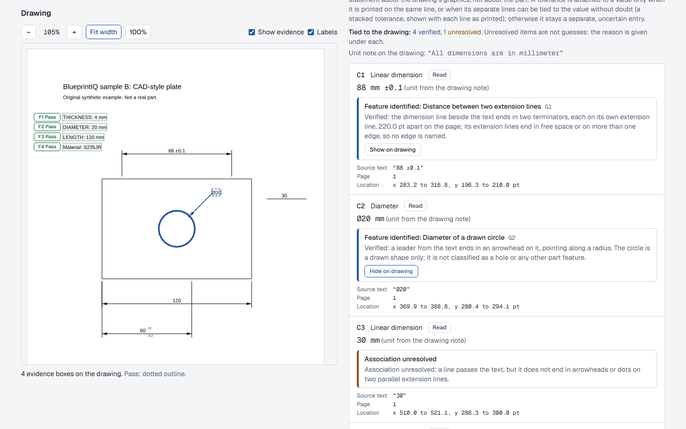
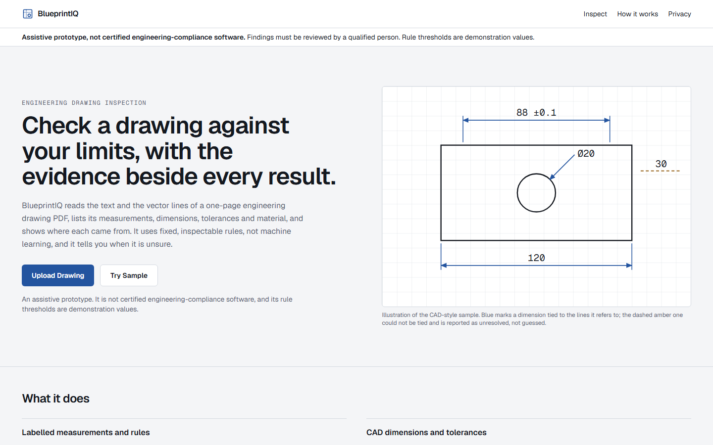
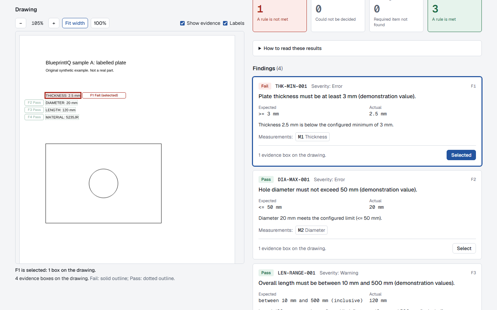
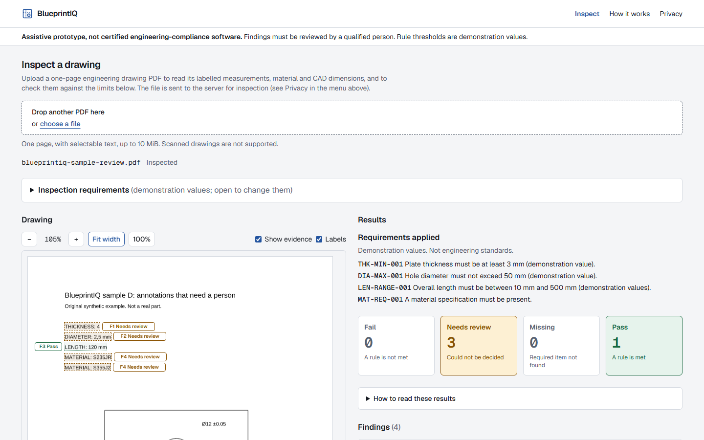
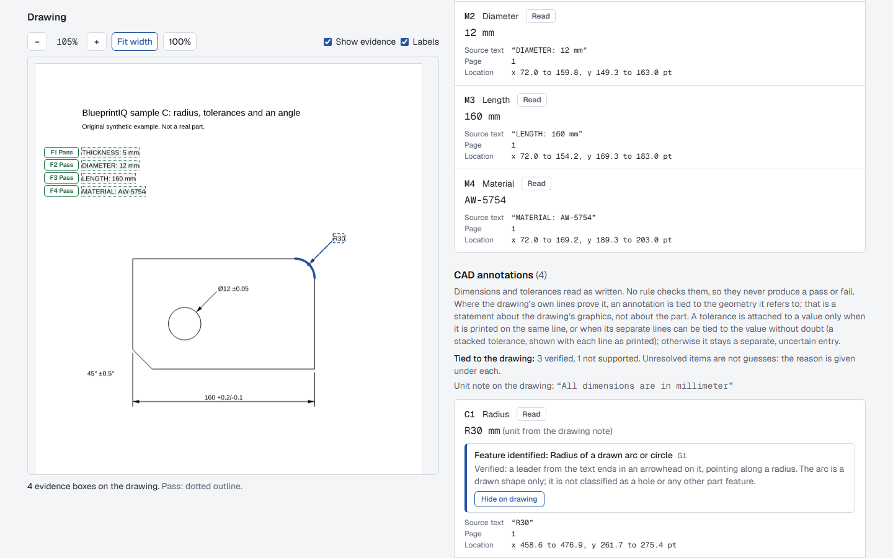
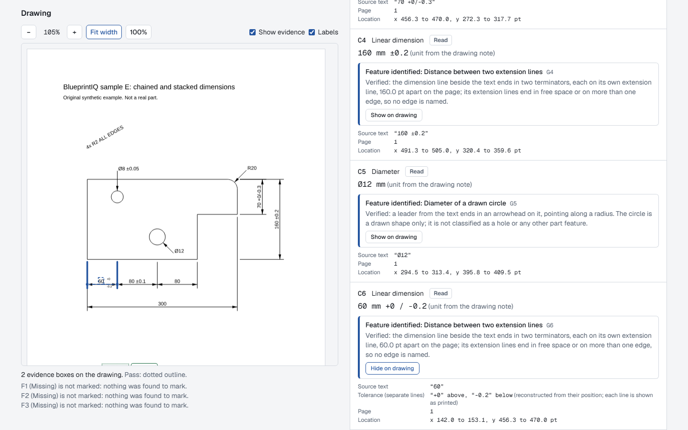
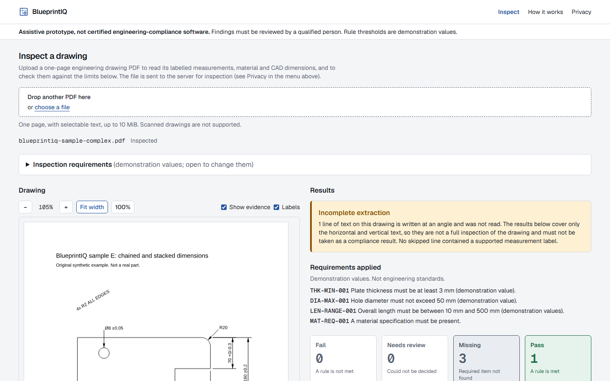
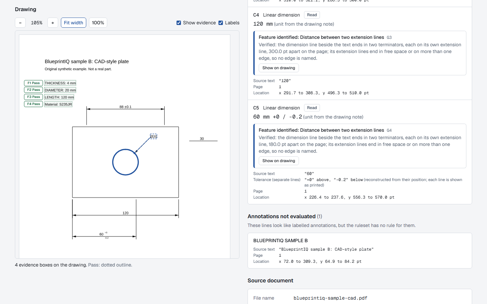
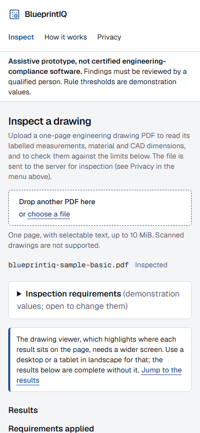
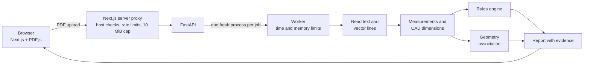

<h1 align="center">BlueprintIQ</h1>

<p align="center">
  <strong>Evidence-backed inspection of engineering drawings.</strong><br>
  Upload a PDF drawing, check its dimensions and material against your limits, and see exactly where every result came from.
</p>

<p align="center">
  <a href="https://blueprintiq-bp9m.onrender.com"><b>Live demo</b></a> &nbsp;·&nbsp; <a href="#try-it-yourself">Sample drawings</a> &nbsp;·&nbsp; <a href="#run-it-locally">Run locally</a>
</p>

<p align="center">
  <a href="https://github.com/SHJony121/BlueprintIQ/actions/workflows/backend-ci.yml"></a>
  <a href="https://github.com/SHJony121/BlueprintIQ/actions/workflows/frontend-ci.yml"></a>
  <a href="https://github.com/SHJony121/BlueprintIQ/actions/workflows/container-ci.yml"></a>
  <a href="LICENSE"></a>
</p>

<p align="center">
  
</p>

> **An assistive prototype, not certified compliance software.** The inspection limits it ships with are demonstration values, not engineering standards, and every result is meant to be checked by a qualified person.

## What it does

BlueprintIQ reads the **text and the vector lines** inside a one-page engineering drawing PDF (the kind a CAD program exports) and turns them into results you can trust or question:

- **Checks labelled values against your limits.** Notes like `THICKNESS: 4 mm` and `MATERIAL: S235JR` become measurements, checked against minimums and maximums you set. Each rule ends as **Pass**, **Fail**, **Missing** or **Needs review**.
- **Reads CAD dimensions and tolerances as written:** `88 ±0.1`, `Ø20`, `R30`, `160 +0.2/-0.1`, and tolerances printed on two lines (`60` with `+0` over `-0.2`).
- **Ties dimensions to the drawing.** When the drawing's own lines prove it (arrowheads on extension lines, a leader ending on a circle or arc), a dimension is linked to the geometry it measures and highlighted on the page. When they don't, it says *unresolved* and why.
- **Shows its evidence.** Every result points to the exact text and lines it came from, drawn over the PDF in the browser.
- **Never guesses.** A value with no unit, a comma decimal or two conflicting materials becomes **Needs review**, never a pass or a fail.
- **No AI, no machine learning.** Fixed, deterministic rules: the same file always gives the same result.

## Screenshots

<table>
  <tr>
    <td width="50%"><br><sub><b>Landing page.</b> What it does, which drawings it supports, and its limits.</sub></td>
    <td width="50%"><br><sub><b>A failed rule and its evidence.</b> The thickness is below the minimum; the box marks the exact text it was read from.</sub></td>
  </tr>
  <tr>
    <td width="50%"><br><sub><b>Needs review, not guesses.</b> A value with no unit, a comma decimal and two different materials are sent to a person.</sub></td>
    <td width="50%"><br><sub><b>Radius tied to its arc.</b> The angle is read but not associated: angles are outside what it supports.</sub></td>
  </tr>
  <tr>
    <td width="50%"><br><sub><b>The hard sheet (sample E).</b> A stacked tolerance picked out of three dimensions chained on one line, with vertical text and leaders around it.</sub></td>
    <td width="50%"><br><sub><b>Honest about what it skipped.</b> An angled note is not read, and a warning says the results are not a full inspection.</sub></td>
  </tr>
  <tr>
    <td width="50%"><br><sub><b>Stacked tolerance.</b> Two separate printed lines rebuilt as <code>60 +0 / -0.2</code>, each kept as printed.</sub></td>
    <td width="50%" align="center"><br><sub><b>On a phone.</b> Full results; the drawing viewer needs a wider screen and says so.</sub></td>
  </tr>
</table>

## Try it yourself

**Live demo: <https://blueprintiq-bp9m.onrender.com>** (a free Render trial: it sleeps after 15 minutes without visitors, so the first load can take a minute or two; it is shared, rate-limited and has no login, so **do not upload confidential drawings**). Or [run it locally](#run-it-locally). Then use these sample drawings. They are original synthetic drawings made for this project (invented parts, no third-party content). Every expected result below was checked against the running app, and tests (`backend/tests/api/test_samples.py`) keep it that way.

| Sample | Shows | Expected result (demonstration limits) |
|---|---|---|
| **A. Labelled plate**<br>[download](frontend/public/samples/blueprintiq-sample-basic.pdf) | Labelled notes checked against rules | **3 Pass, 1 Fail**: thickness 2.5 mm is below the 3 mm minimum |
| **B. CAD-style plate**<br>[download](frontend/public/samples/blueprintiq-sample-cad.pdf) | Dimension lines, arrowheads, a leader, `±` and stacked tolerances | **4 Pass**. Five CAD dimensions: `120`, `88 ±0.1`, `60 +0/-0.2`, `Ø20` tied to the drawing; `30` **unresolved** (no arrowheads) |
| **C. Radius, tolerances, angle**<br>[download](frontend/public/samples/blueprintiq-sample-features.pdf) | `R30` on a rounded corner, `Ø12 ±0.05`, `160 +0.2/-0.1`, a chamfer angle | **4 Pass**. Radius, diameter and linear tied to the drawing; `45° ±0.5°` read, association **not supported** |
| **D. Needs a person**<br>[download](frontend/public/samples/blueprintiq-sample-review.pdf) | Values that must not be guessed | **1 Pass, 3 Needs review, 0 Fail**; two ambiguous CAD lines left untied |
| **E. Complex bracket** (hardest)<br>[download](frontend/public/samples/blueprintiq-sample-complex.pdf) | A dense CAD sheet: three dimensions chained on one shared line, a stacked and three inline tolerances, vertical dimension text, two leaders and a rounded corner, a unit note in English and French, material in two languages, and a note written at an angle | **1 Pass, 3 Missing, 0 Fail** (no labelled thickness, diameter or length, as on many real CAD sheets; the material is the same text twice, so it passes). **9 CAD dimensions, all tied to the drawing.** The angled note is **not read**, and the report says so ("Incomplete extraction") |

**Walkthrough.**

1. Open the live demo or your local copy at `/inspect`. Drop a sample PDF on the upload area, or press a **Try a sample** button (samples A and B).
2. The inspection runs at once against the demonstration limits (thickness at least 3 mm, diameter at most 50 mm, length 10 to 500 mm, a material written). Open **Inspection requirements** to change them and press **Run inspection**.
3. Read the summary (Fail, Needs review, Missing, Pass) and each finding: the rule, the expected and actual value, and the measurement used.
4. Look at **Extracted measurements** and **CAD annotations** to see what was read and how.
5. On a wide screen, select a finding to highlight its evidence, or press **Show on drawing** on a CAD dimension to see the lines it is tied to.

**Rule findings and geometry associations are different things.** A *rule finding* compares a labelled value with your limit and can pass or fail. A *geometry association* only says which drawn lines or circle a dimension refers to: it is *verified*, *unresolved* (with the reason) or *not supported*, and it can never fail a part.

<details>
<summary><b>New to engineering drawings?</b></summary>

A *dimension* is a measurement printed on the drawing. Its *tolerance* says how far the real part may differ (`±0.1`, or `+0` above `-0.2` printed as a *stacked* tolerance). *Extension lines* run from the part to the *dimension line*, whose arrowheads mark what is measured. A *leader* is a line from a note to a feature such as a hole.
</details>

## How it works



- **Extraction** (PyMuPDF): visible text lines with exact page positions, and the drawing's lines, circles, arcs and arrowheads. Clipped, hidden and angled text is not treated as readable.
- **Parsing** with exact decimals and unit conversion; anything uncertain is flagged, never guessed.
- **Rules** from a TOML file or from the limits you enter, evaluated deterministically.
- **Isolation:** every inspection runs in its own short-lived process with a time limit and a memory cap, so a bad file cannot take the service down.
- **Viewer:** PDF.js renders the drawing in the browser and the evidence is drawn in the same coordinates, correct for rotated and cropped pages.

More detail: [architecture](docs/architecture.md), [CAD annotations](docs/cad-annotations.md), [feature association](docs/feature-association.md).

## Tech stack

| Area | Technology |
|---|---|
| Backend | Python 3.12, FastAPI, Pydantic, PyMuPDF, uvicorn |
| Frontend | Next.js 16, React 19, TypeScript, Tailwind CSS 4, PDF.js |
| Quality | pytest, mypy (strict), ruff, Vitest, Testing Library, Playwright |
| Delivery | Docker (single non-root container), GitHub Actions |

## Run it locally

Requirements: Python 3.12+, [uv](https://docs.astral.sh/uv/), Node.js 24 (22.13+ works).

```bash
# terminal 1: backend
cd backend
uv sync --locked
uv run uvicorn blueprintiq.api.app:create_app --factory --host 127.0.0.1 --port 8000
```

```bash
# terminal 2: frontend
cd frontend
npm ci
npm run build
npm run start
```

Open <http://127.0.0.1:3000>. Use these commands (they bind to `127.0.0.1`); the app has no login, so do not expose it on a network as is.

**Or with Docker** (the production setup, see [deployment](docs/deployment.md)):

```bash
docker build --build-arg SOURCE_URL=https://github.com/SHJony121/BlueprintIQ -t blueprintiq .
docker run --rm -p 127.0.0.1:8080:8080 -e BLUEPRINTIQ_ALLOWED_HOSTS=localhost:8080 blueprintiq
# then open http://localhost:8080
```

## Testing

Everything runs in GitHub Actions on Linux on every push, and nothing is merged with a red check. Counts are from the latest full runs.

| Suite | Command | Tests |
|---|---|---|
| Backend (ruff, mypy `--strict`, pytest), including worker failure, memory-limit and fork-server recovery tests | `cd backend && uv run pytest` | 1,473 |
| Frontend unit and component (Vitest) | `cd frontend && npm test` | 883 |
| Proxy against the real Next.js production server | `npm run test:server` (after `npm run build`) | 41 |
| Frontend against the real FastAPI backend | `npm run test:backend` | 185 |
| Browser (Chromium, Playwright), real backend, three pixel densities | `npm run test:e2e` (after build) | 248 |
| Container: non-root, read-only, health check, headers, host and origin checks, rate limit, clean shutdown | `container-ci` workflow | n/a |
| Failure recovery at 512 MiB and 0.1 CPU (memory exhaustion, a failing fork server, client disconnects) | `resilience` workflow | n/a |

Also `npm run lint`, `npm run typecheck` and `npm run api:check` (generated API types match `backend/openapi.json`). Results are checked against **32 synthetic drawings and generated geometry** whose expected outcomes are written independently of the code under test, and the four downloadable samples above. Details: [testing and evaluation](docs/testing-and-evaluation.md).

## Limitations

* **Tested on synthetic drawings and one real CAD export.** Real-world coverage (embedded fonts, per-glyph positioning, hatch clips) and Japanese drawings are not benchmarked; some valid drawings will be refused or flagged ambiguous. No accuracy figure is claimed.
* **One page, selectable text only.** No scans or OCR, no DWG, no multi-page files, no `/UserUnit` scaling.
* **Angled text is not read.** It is skipped and the report says "Incomplete extraction" with the number of lines. If such a line carries a supported label (`THICKNESS:` and so on), the file is refused (`UNSUPPORTED_GEOMETRY`) instead.
* **Conventions it understands:** English labels and a documented annotation grammar. CAD dimensions and tolerances (`2.7 ±0.1`, `Ø12`, `R1.5`, `75° ±0.5°`) are listed as **CAD annotations**, read as written; no rule checks them ([CAD annotations](docs/cad-annotations.md)). GD&T frames, threads, ordinate dimensions and comma decimals are not read.
* **Geometry association** needs the drawing's own vector lines to prove it (arrowheads on a circle, an arc or two extension lines); otherwise it says why it is unresolved. Angles are read but never tied to geometry. Linear dimensions were checked on one real drawing; diameter and radius associations have been tested on generated PDFs only ([feature association](docs/feature-association.md)).
* **Rules apply per labelled measurement type**, not per feature. Material rules check that a material is written, or match a code exactly; they never judge suitability. The default limits are demonstration constraints; user limits are the four in [custom requirements](docs/custom-requirements.md) and are not saved.
* **Overlay alignment** is measured on synthetic pages (Helvetica and Courier); a misplacement under about 3 pt would not be detected by the tests. The drawing viewer needs a screen at least 1024 px wide; on narrower screens the findings still work without it.
* **Speed:** about 0.5 to 5 s per drawing on the free tier; on Windows a fresh worker process costs about 1.2 s per request.

Full list: [testing and evaluation](docs/testing-and-evaluation.md#limitations).

## Security and deployment

The demo runs as a **single non-root container on Render's free tier** (https://blueprintiq-bp9m.onrender.com). Uploads are streamed with a 10 MiB cap, validated, and processed in isolated worker processes with time and memory limits. The container adds host allow-listing, per-client rate limits (checked on the live site: a forged `X-Forwarded-For` does not dodge them), security headers, a read-only filesystem, and no diagnostic or API-documentation endpoints. It was measured at the free tier's limits (512 MiB, 0.1 CPU) before deploying.

It is a **trial**: there is no authentication, results are not stored, and the service can be restarted or suspended at any time. Details: [security](docs/security-and-deployment.md), [deployment](docs/deployment.md), [free hosting](docs/free-hosting.md), [Render Free guide](docs/render-free.md).

## Project documentation

[Architecture](docs/architecture.md) · [Walkthrough](docs/walkthrough.md) · [Custom requirements](docs/custom-requirements.md) · [CAD annotations](docs/cad-annotations.md) · [Feature association](docs/feature-association.md) · [Testing](docs/testing-and-evaluation.md) · [Security](docs/security-and-deployment.md) · [Deployment](docs/deployment.md) · [Design spec](docs/design/phase1-mvp-spec.md)

<details>
<summary><b>API, errors and settings</b></summary>

| Endpoint | Purpose |
|---|---|
| `GET /healthz` | Liveness only; reveals no configuration. |
| `POST /api/v1/inspections` | Body: the PDF bytes, `Content-Type: application/pdf`. Optional `X-Filename` (percent-encoded, display only) and `X-Inspection-Requirements` (percent-encoded JSON, at most 2048 characters; see [custom requirements](docs/custom-requirements.md)). Returns an `InspectionReport`. |

Every error is `{"error": {"code", "message", "request_id"}}` with the same id in the `X-Request-ID` header. Codes: `FILE_TOO_LARGE` (413), `UNSUPPORTED_CONTENT_TYPE` / `UNSUPPORTED_FILE_TYPE` (415), `UPLOAD_TIMEOUT` (408), `RATE_LIMITED` / `TOO_MANY_UPLOADS` (429), `SERVER_BUSY` (503), `INTERNAL_ERROR` (500), `422` for PDFs that are refused or exceed limits (`INVALID_PDF`, `ENCRYPTED_PDF`, `TOO_MANY_PAGES`, `NO_TEXT_LAYER`, `UNSUPPORTED_GEOMETRY`, `PARTIALLY_VISIBLE_TEXT`, `PAGE_TOO_COMPLEX`, `TOO_MANY_TEXT_LINES`, `PROCESSING_TIMEOUT`, `RESOURCE_LIMIT_EXCEEDED`, `PROCESSING_FAILED`) and `422 INVALID_REQUIREMENTS`. Full contract: [design spec §17](docs/design/phase1-mvp-spec.md).

Upload a synthetic drawing to a local backend (from `backend/`):

```bash
curl -s -X POST http://127.0.0.1:8000/api/v1/inspections \
  -H "Content-Type: application/pdf" -H "X-Filename: violations.pdf" \
  --data-binary @tests/fixtures/drawings/violations.pdf
```

An excerpt of the real output (`violations.pdf`):

```json
{
  "measurements": [
    {"id": "M1", "kind": "dimension", "dimension_type": "thickness",
     "value": "2", "unit": "mm", "normalized_value_mm": "2", "status": "parsed",
     "source": {"page_number": 1, "raw_text": "THICKNESS: 2 mm",
                "bbox": {"x0": 72.0, "y0": 549.25, "x1": 159.79, "y1": 562.99}}}
  ],
  "findings": [
    {"id": "F1", "rule_id": "THK-MIN-001", "status": "fail", "severity": "error",
     "measurement_ids": ["M1"], "expected": ">= 3 mm", "actual": "2 mm",
     "message": "Thickness 2 mm is below the configured minimum of 3 mm."}
  ],
  "summary": {"passed": 1, "failed": 3, "missing": 0, "needs_review": 0}
}
```

More fixtures in `backend/tests/fixtures/drawings/`: `ambiguous.pdf` (every outcome `needs_review`), `conflicting.pdf` (4 mm vs 6 mm thickness), `missing_material.pdf`, `unit_conversion.pdf` (`0.3 cm` is exactly 3 mm), `cropped_rotated_90.pdf`; `multi_page.pdf` is refused with `422 TOO_MANY_PAGES`.

Settings (environment variables, prefix `BLUEPRINTIQ_`): `RULESET_PATH`, `MAX_UPLOAD_BYTES`, `JOB_TIMEOUT_S`, `JOB_MEMORY_LIMIT_MB`, `JOB_DATA_LIMIT_MB`, `MAX_CONCURRENT_JOBS`, `MAX_ADMITTED_REQUESTS`, `QUEUE_TIMEOUT_S`, `UPLOAD_TIMEOUT_S`, `WORKER_START_METHOD`, `LOG_LEVEL`, and for the container `ALLOWED_HOSTS`, `TRUSTED_PROXY_HOPS` and the rate-limit variables ([deployment](docs/deployment.md)). The default ruleset is `backend/src/blueprintiq/rules/demo_rules.toml`; set `BLUEPRINTIQ_RULESET_PATH` for your own.
</details>

<details>
<summary><b>Module map</b></summary>

| Module | Responsibility |
|---|---|
| `domain/` | Pydantic models, exact `Decimal` units, evidence geometry; the report validator rejects a confirmed outcome built on an uncertain measurement. |
| `ingestion/`, `extraction/text_layer.py`, `reader.py` | Safe PDF reading, visibility, coordinates, line segmentation, cost limits. |
| `extraction/annotation_parser.py` | Text lines to measurements; ambiguity is flagged, never guessed. |
| `extraction/cad_annotations.py`, `feature_association.py`, `vector_geometry.py` | CAD dimensions and tolerances, and the vector-geometry association. |
| `rules/`, `inspection.py` | TOML rules and your own limits, deterministic evaluation, duplicate and conflict policy. |
| `api/` | HTTP layer, upload safety, process isolation, logging. |
| `frontend/src/server`, `src/inspection`, `src/viewer` | Server proxy, the inspection state machine, the PDF.js viewer with evidence overlays. |
</details>

<details>
<summary><b>Local use: start it only through the documented commands</b></summary>

`npm run dev` and `npm run start` bind Next.js to `127.0.0.1`; Next's own default is every network interface, so `npx next start` without the flag would expose the unauthenticated backend through the proxy. Keep uvicorn on `127.0.0.1` too. The proxy's `Host` and `Origin` checks defend against web pages, not other machines, and do not replace the binding. The container binds a public port deliberately and requires an explicit host allow-list.
</details>

<details>
<summary><b>Roadmap</b></summary>

1. Benchmark on real, permissioned CAD PDFs.
2. A shared rate limiter if it ever runs on more than one instance (the current limiter is per instance).
3. Report export and multi-page viewing.
4. Optional, later: assistive interpretation of scanned or unlabeled drawings, kept behind the same evidence and uncertainty rules, with a human review step.
</details>

<details>
<summary><b>Repository layout</b></summary>

```
backend/src/blueprintiq/   extraction, rules, API, worker isolation
backend/tests/             unit, integration and API tests, synthetic fixtures
backend/scripts/           fixture and sample generators
frontend/src/              Next.js app, server proxy, inspection UI, PDF viewer
frontend/public/samples/   the downloadable sample drawings
frontend/tests/            proxy, UI and browser tests
deploy/                    container entrypoint, health check, smoke test, benchmarks
docs/                      design, architecture, testing, deployment, screenshots
```
</details>

## Licence

Free software under the **GNU Affero General Public License v3.0 or later** ([LICENSE](LICENSE)). Copyright (C) 2026 Shahriar Hasan Jony. The PDF engine, PyMuPDF/MuPDF, is AGPL-3.0, so the whole project is too: anyone using a deployed copy is entitled to its source, and the site's footer links it. Third-party licences: [NOTICE.md](NOTICE.md). No warranty; not certified engineering-compliance software.
