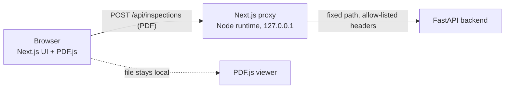
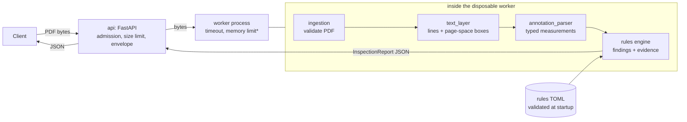

# BlueprintIQ

**Engineering drawing intelligence.** BlueprintIQ reads labeled annotations (`THICKNESS: 4 mm`, `MATERIAL: SS400`, …) from 2D vector engineering drawings in PDF form, checks them against configurable inspection rules, and returns findings that point back to the exact place on the drawing where each value was read.

> **Assistive prototype, not certified compliance software.** BlueprintIQ does not guarantee engineering safety, regulatory compliance, or manufacturing correctness. The rule thresholds shipped here are **demonstration values**, not industry or company standards. Findings must be reviewed by a qualified person.

> **Status:** a working **local full-stack MVP** (FastAPI backend plus Next.js frontend with a PDF viewer). It is verified against **synthetic fixtures only**; real industrial CAD PDFs, embedded fonts and Japanese drawings have not been tested. It is for **trusted local use**; public deployment is blocked (see [Security](docs/security-and-deployment.md)). The repository is private and unlicensed.

## What it does

```
PDF drawing ─▶ validated text lines with page-space boxes ─▶ typed measurements ─▶ rule findings with evidence
```

* **Deterministic.** No AI model is involved. Every value, comparison and explanation is reproducible.
* **Honest about uncertainty.** An annotation the parser cannot read with certainty (`THICKNESS: 4` with no unit, `2,5 mm`, `100 ± 0.5 mm`, `4 M`) is kept as **ambiguous** and can only ever produce **`needs_review`**, never a confirmed pass or fail. A missing annotation is **`missing`**, which is different from a known violation.
* **Traceable.** Each finding cites the measurements it used; each measurement carries its raw text, page number and bounding box.
* **Exact.** All numbers are `Decimal`. Unit conversion (mm, cm, m, in) is exact; JSON carries numbers as strings.

## What works today (verified) and what does not

**Verified in this repository** (synthetic fixtures; see Testing):

* Single-page, text-based engineering PDFs: extraction of dimension annotations (thickness, diameter, length, with units) and material annotations.
* Deterministic evaluation of a demonstration ruleset, with four outcomes: `pass`, `fail`, `missing`, `needs_review`.
* A browser UI: upload or drop a PDF, see summary counts and findings, extracted measurements and source metadata, with plain-language explanations of every error.
* The PDF rendered in the browser (PDF.js) with an evidence box on the exact text each finding relied on, correct for page rotation (0/90/180/270), crop boxes, zoom and screen pixel density.
* Selecting a finding highlights its boxes and selecting a box selects its finding, by mouse and keyboard.

**Not done:** real-CAD benchmarking, multi-page documents, scanned drawings, authentication, rate limiting, deployment, report export, any AI model. See [Known limitations](#known-limitations).

## Quick start (backend and frontend, local only)

Requirements: Python 3.12+, [uv](https://docs.astral.sh/uv/), Node.js 24 (22.13+ works), npm. Tested on Windows 11 and Linux (CI).

```bash
# 1. backend (terminal 1)
cd backend
uv sync --locked
uv run uvicorn blueprintiq.api.app:create_app --factory --host 127.0.0.1 --port 8000

# 2. frontend (terminal 2)
cd frontend
npm ci
npm run build
npm run start          # http://127.0.0.1:3000  (or: npm run dev)
```

Open <http://127.0.0.1:3000>. The browser only talks to the Next.js app; its server-side proxy forwards uploads to the backend at `http://127.0.0.1:8000` (change with the server-only `BLUEPRINTIQ_BACKEND_URL`, which must be a loopback IP).

**Start both only through these commands.** `npm run dev` and `npm run start` bind Next.js to `127.0.0.1`; Next's own default is every network interface, so `npx next start` would expose the unauthenticated backend through the proxy. The proxy's `Host`/`Origin` checks defend against web pages, not other machines, and do not replace the binding. Keep uvicorn on `127.0.0.1` too.

### Using it

1. Drop a PDF on the drop area (or choose one). Try the demonstration fixtures in `backend/tests/fixtures/drawings/`: `valid_basic.pdf` (4 pass), `violations.pdf` (3 fail, 1 pass), `ambiguous.pdf` (all `needs_review`), `missing_material.pdf` (material `missing`), `cropped_rotated_90.pdf` (rotated and cropped page). Limits: one page, selectable text, 10 MiB.
2. Read the summary cards (Fail, Needs review, Missing, Pass) and the findings: rule, severity, expected, actual, explanation, referenced measurements.
3. On a wide screen (1024 px and up) the drawing appears beside the results with a box on each piece of evidence (fail solid, needs review dashed, pass dotted). Zoom, fit width, or hide the evidence and labels.
4. Select a finding (its **Select** button or the card) to highlight its boxes and bring them into view; click or Tab to a box and press Enter to select its finding. A finding with no location is selectable and says why nothing is marked.

Screenshots of the real running app are in [docs/screenshots/](docs/screenshots/) and embedded in [F2](docs/frontend-f2.md), [F3](docs/frontend-f3.md) and [F4](docs/frontend-f4.md).

### Backend only

```bash
cd backend
uv run pytest                    # 1134 tests (3 skipped on Windows)
```

Interactive API docs: <http://127.0.0.1:8000/docs>

### API demonstration

Upload a synthetic drawing (from the `backend/` directory, with the server running):

```bash
curl -s http://127.0.0.1:8000/healthz
# {"status":"ok"}

curl -s -X POST http://127.0.0.1:8000/api/v1/inspections \
  -H "Content-Type: application/pdf" \
  -H "X-Filename: violations.pdf" \
  --data-binary @tests/fixtures/drawings/violations.pdf
```

The response is an `InspectionReport`. An excerpt of the real output for `violations.pdf`:

```json
{
  "document": {"filename": "violations.pdf", "page_count": 1, "size_bytes": 1319},
  "measurements": [
    {"id": "M1", "kind": "dimension", "dimension_type": "thickness",
     "value": "2", "unit": "mm", "normalized_value_mm": "2", "status": "parsed",
     "source": {"page_number": 1, "raw_text": "THICKNESS: 2 mm",
                "bbox": {"x0": 72.0, "y0": 549.25, "x1": 159.79, "y1": 562.99}}}
  ],
  "findings": [
    {"id": "F1", "rule_id": "THK-MIN-001", "status": "fail", "severity": "error",
     "measurement_ids": ["M1"],
     "evidence": [{"measurement_id": "M1", "page_number": 1,
                   "bbox": {"x0": 72.0, "y0": 549.25, "x1": 159.79, "y1": 562.99}}],
     "expected": ">= 3 mm", "actual": "2 mm",
     "message": "Thickness 2 mm is below the configured minimum of 3 mm."}
  ],
  "summary": {"passed": 1, "failed": 3, "missing": 0, "needs_review": 0}
}
```

Try the other fixtures in `backend/tests/fixtures/drawings/`: `ambiguous.pdf` (every outcome is `needs_review`), `conflicting.pdf` (4 mm vs 6 mm thickness → `needs_review`, never a verdict), `missing_material.pdf` (`MAT-REQ-001` is `missing`), `unit_conversion.pdf` (`0.3 cm` = exactly 3 mm, a boundary pass), `rotated_90.pdf`, `cropped_rotated_90.pdf`. Refused files return a typed error, e.g. `multi_page.pdf` → `422 TOO_MANY_PAGES`.

A worked walkthrough is in [docs/walkthrough.md](docs/walkthrough.md).

## Frontend



* **Proxy** (`frontend/src/server`): one route; server-only loopback backend address, header allow-list, streamed upload counted against 10 MiB, response size and shape checks, no redirects followed, timeouts, abort on disconnect ([F1](docs/frontend-f1.md)).
* **Dashboard** (`src/components`, `src/inspection`, `src/api`): one state machine, types generated from the backend's OpenAPI snapshot, runtime-checked responses ([F2](docs/frontend-f2.md)).
* **Viewer** (`src/viewer`): PDF.js rendering, pure coordinate mapping through PDF.js's own viewport, file-identity and page-geometry checks before any box is drawn ([F3](docs/frontend-f3.md)).
* **Linking**: finding and box selection kept in sync ([F4](docs/frontend-f4.md)).

## API

| Endpoint | Purpose |
|---|---|
| `GET /healthz` | Liveness only; reveals no configuration. |
| `POST /api/v1/inspections` | Body: the PDF bytes, `Content-Type: application/pdf`. Optional `X-Filename` header (percent-encoded, display only). Returns an `InspectionReport`. |

Every error is `{"error": {"code", "message", "request_id"}}` with the same id in the `X-Request-ID` header. Codes: `FILE_TOO_LARGE` (413), `UNSUPPORTED_CONTENT_TYPE` / `UNSUPPORTED_FILE_TYPE` (415), `UPLOAD_TIMEOUT` (408), `SERVER_BUSY` (503), `INTERNAL_ERROR` (500), and `422` for PDFs that are refused or exceed limits (`INVALID_PDF`, `ENCRYPTED_PDF`, `TOO_MANY_PAGES`, `NO_TEXT_LAYER`, `UNSUPPORTED_GEOMETRY`, `PARTIALLY_VISIBLE_TEXT`, `PAGE_TOO_COMPLEX`, `TOO_MANY_TEXT_LINES`, `PROCESSING_TIMEOUT`, `RESOURCE_LIMIT_EXCEEDED`, `PROCESSING_FAILED`). Full contract: [spec §17](docs/design/phase1-mvp-spec.md).

Settings (environment variables, prefix `BLUEPRINTIQ_`): `RULESET_PATH`, `MAX_UPLOAD_BYTES`, `JOB_TIMEOUT_S`, `JOB_MEMORY_LIMIT_MB`, `MAX_CONCURRENT_JOBS`, `MAX_ADMITTED_REQUESTS`, `QUEUE_TIMEOUT_S`, `UPLOAD_TIMEOUT_S`, `LOG_LEVEL`. The default ruleset is the demonstration file shipped inside the package (`backend/src/blueprintiq/rules/demo_rules.toml`); set `BLUEPRINTIQ_RULESET_PATH` to use your own.

## How the pieces fit



\* the memory limit is enforced on Linux only.

| Milestone | Module | Responsibility |
|---|---|---|
| M1 | `domain/` | Pydantic models, exact `Decimal` units, evidence geometry; the report validator rejects a confirmed outcome built on an uncertain measurement. |
| M2 | `extraction/annotation_parser.py` | Text lines → measurements; ambiguity is flagged, never guessed. |
| M3 | `ingestion/`, `extraction/text_layer.py`, `reader.py` | Safe PDF reading, visibility, coordinates, segmentation, cost limits. |
| M4 | `rules/`, `inspection.py` | TOML rules, deterministic evaluation, duplicate/conflict policy. |
| M5 | `api/` | HTTP layer, upload safety, process isolation, logging. |

Details: [docs/architecture.md](docs/architecture.md).

## Testing and evaluation

All executed and passing in GitHub Actions (Linux) on the milestone commit; no accuracy percentage is claimed.

| Suite | Command | Count |
|---|---|---|
| Backend (ruff, mypy --strict, pytest) | `cd backend && uv run pytest` | 1134 |
| Frontend unit and component (Vitest) | `cd frontend && npm test` | 688 |
| Proxy against the real Next.js server, launch binding | `npm run test:server` (after `npm run build`) | 24 |
| Frontend against the real FastAPI backend | `npm run test:backend` | 180 |
| Browser, Chromium via Playwright, real backend | `npm run test:e2e` (after build; first `npx playwright install chromium`) | 226 |

Also `npm run lint`, `npm run typecheck`, `npm run api:check` (generated API types match `backend/openapi.json`). Details: [docs/testing-and-evaluation.md](docs/testing-and-evaluation.md) (backend) and [F3](docs/frontend-f3.md#verification) (how overlay alignment is measured against rendered pixels and independent ground truth). Correctness is shown on **32 synthetic fixtures** (plus 12 generated geometry cases) whose expected results are written independently of the code under test; there is **no benchmark on real CAD drawings**.

## Known limitations

* Verified on synthetic drawings only; real CAD output (embedded fonts, per-glyph positioning, hatch clips) and **Japanese drawings are not benchmarked**, and some valid drawings will be refused or flagged ambiguous.
* The PDF viewer appears only at desktop widths (1024 px and up); on narrower screens the findings still work without it.
* Overlay alignment is measured on synthetic pages (Helvetica and Courier); misplacement smaller than about 3 pt would not be detected by the tests.
* One F1 proxy test failed once, unexplained, and never recurred (details in [F2](docs/frontend-f2.md#known-limitations-and-notes)); no other known flaky tests. Browser tests need Chromium installed.
* Single-page, vector/text PDFs only; no scans/OCR, DWG, multi-page, text at non-right angles, `/UserUnit` scaling.
* English labels and the documented annotation grammar only; no `Ø`, tolerances, ranges or component association (rules apply per measurement type, not per feature).
* Material rules check **presence only**, never the grade.
* Rules are demonstration constraints.
* About 1.2 s per request on Windows (a fresh worker process each time).

Full list: [docs/testing-and-evaluation.md](docs/testing-and-evaluation.md#limitations) and [docs/security-and-deployment.md](docs/security-and-deployment.md).

## Security and release restrictions

**Trusted local use only. Public deployment is blocked.** No authentication, rate limiting or TLS (the Next.js proxy adds none); no worker memory limit on Windows (Linux only); inspections are not cancelled when a client disconnects; real CAD PDFs not benchmarked; and **PyMuPDF is AGPL-3.0 / commercial**, so a licensing decision (publish under AGPL-3.0, buy a licence, or switch to a permissive engine such as pypdfium2 — see [ADR-001](docs/design/adr-001-pdf-engine.md)) is required before the repository is made public. See [docs/security-and-deployment.md](docs/security-and-deployment.md).

## Roadmap

1. **Phase 1.5 (hardening):** benchmark on real, permissioned CAD PDFs; warm worker pool; disconnect cancellation; clip-scope handling; licence decision.
2. **Phase 2 (frontend):** done locally on `feat/phase2a-frontend` ([F0](docs/frontend-f0.md) scaffold, [F1](docs/frontend-f1.md) proxy, [F2](docs/frontend-f2.md) dashboard, [F3](docs/frontend-f3.md) viewer and overlays, [F4](docs/frontend-f4.md) linking). Not done: report export, multi-page viewing, a Docker or deployment story.
3. **Phase 3 (assistive AI, optional):** vision-language interpretation for scanned/unlabeled drawings behind the same evidence and uncertainty rules; human review workflow.

## Repository layout

```
backend/src/blueprintiq/   domain, ingestion, extraction, rules (+ demo_rules.toml), api, inspection.py
backend/tests/             unit, integration, api, fixtures (PDFs + independent ground truth)
backend/scripts/           generate_fixtures.py
docs/design/               Phase 1 specification, ADR-001
backend/openapi.json       API contract snapshot; frontend types are generated from it
frontend/src/              app (routes, proxy route), server (proxy), api, inspection, components, viewer
frontend/tests/            proxy, ui, e2e (Playwright; geometry_fixtures.py generates extra test PDFs)
docs/                      architecture, walkthrough, testing & evaluation, security, frontend-f0..f4
docs/screenshots/          real screenshots of the running app (F2, F3, F4)
.github/workflows/         backend-ci.yml; frontend-ci.yml (checks, proxy-backend, browser)
```
