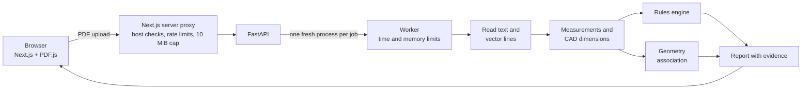

<h1 align="center">BlueprintIQ</h1>

<p align="center">
  <strong>Evidence-backed inspection of engineering drawings.</strong><br>
  Upload a PDF drawing, check its dimensions and material against your limits, and see exactly where every result came from.
</p>

<p align="center">
  <a href="https://github.com/SHJony121/BlueprintIQ/actions/workflows/backend-ci.yml"></a>
  <a href="https://github.com/SHJony121/BlueprintIQ/actions/workflows/frontend-ci.yml"></a>
  <a href="https://github.com/SHJony121/BlueprintIQ/actions/workflows/container-ci.yml"></a>
  <a href="LICENSE"></a>
</p>

<p align="center">
  
</p>

> **An assistive prototype, not certified compliance software.** The inspection limits it ships with are demonstration values, not engineering standards, and every result is meant to be checked by a qualified person.

## What it does

BlueprintIQ reads the **text and the vector lines** inside a one-page engineering drawing PDF (the kind a CAD program exports) and turns them into results you can trust or question:

- **Checks labelled values against your limits.** Notes like `THICKNESS: 4 mm` and `MATERIAL: S235JR` become measurements, checked against minimums and maximums you set. Each rule ends as **Pass**, **Fail**, **Missing** or **Needs review**.
- **Reads CAD dimensions and tolerances as written:** `88 ±0.1`, `Ø20`, `R30`, `160 +0.2/-0.1`, and tolerances printed on two lines (`60` with `+0` over `-0.2`).
- **Ties dimensions to the drawing.** When the drawing's own lines prove it (arrowheads on extension lines, a leader ending on a circle or arc), a dimension is linked to the geometry it measures and highlighted on the page. When they don't, it says *unresolved* and why.
- **Shows its evidence.** Every result points to the exact text and lines it came from, drawn over the PDF in the browser.
- **Never guesses.** A value with no unit, a comma decimal or two conflicting materials becomes **Needs review**, never a pass or a fail.
- **No AI, no machine learning.** Fixed, deterministic rules: the same file always gives the same result.

## Screenshots

<table>
  <tr>
    <td width="50%"><br><sub><b>Landing page.</b> What it does, which drawings it supports, and its limits.</sub></td>
    <td width="50%"><br><sub><b>A failed rule and its evidence.</b> The thickness is below the minimum; the box marks the exact text it was read from.</sub></td>
  </tr>
  <tr>
    <td width="50%"><br><sub><b>Needs review, not guesses.</b> A value with no unit, a comma decimal and two different materials are sent to a person.</sub></td>
    <td width="50%"><br><sub><b>Radius tied to its arc.</b> The angle is read but not associated: angles are outside what it supports.</sub></td>
  </tr>
  <tr>
    <td width="50%"><br><sub><b>Stacked tolerance.</b> Two separate printed lines rebuilt as <code>60 +0 / -0.2</code>, each kept as printed.</sub></td>
    <td width="50%" align="center"><br><sub><b>On a phone.</b> Full results; the drawing viewer needs a wider screen and says so.</sub></td>
  </tr>
</table>

## Try it yourself

There is **no public live demo yet**. [Run it locally](#run-it-locally) in a few minutes, then use these sample drawings. They are original synthetic drawings made for this project (invented parts, no third-party content). Every expected result below was checked against the running app, and tests (`backend/tests/api/test_samples.py`) keep it that way.

| Sample | Shows | Expected result (demonstration limits) |
|---|---|---|
| **A. Labelled plate**<br>[download](frontend/public/samples/blueprintiq-sample-basic.pdf) | Labelled notes checked against rules | **3 Pass, 1 Fail**: thickness 2.5 mm is below the 3 mm minimum |
| **B. CAD-style plate**<br>[download](frontend/public/samples/blueprintiq-sample-cad.pdf) | Dimension lines, arrowheads, a leader, `±` and stacked tolerances | **4 Pass**. Five CAD dimensions: `120`, `88 ±0.1`, `60 +0/-0.2`, `Ø20` tied to the drawing; `30` **unresolved** (no arrowheads) |
| **C. Radius, tolerances, angle**<br>[download](frontend/public/samples/blueprintiq-sample-features.pdf) | `R30` on a rounded corner, `Ø12 ±0.05`, `160 +0.2/-0.1`, a chamfer angle | **4 Pass**. Radius, diameter and linear tied to the drawing; `45° ±0.5°` read, association **not supported** |
| **D. Needs a person**<br>[download](frontend/public/samples/blueprintiq-sample-review.pdf) | Values that must not be guessed | **1 Pass, 3 Needs review, 0 Fail**; two ambiguous CAD lines left untied |

**Walkthrough.** Start the app and open <http://127.0.0.1:3000/inspect>.

1. Drop a sample PDF on the upload area, or press a **Try a sample** button (samples A and B).
2. The inspection runs at once against the demonstration limits (thickness at least 3 mm, diameter at most 50 mm, length 10 to 500 mm, a material written). Open **Inspection requirements** to change them and press **Run inspection**.
3. Read the summary (Fail, Needs review, Missing, Pass) and each finding: the rule, the expected and actual value, and the measurement used.
4. Look at **Extracted measurements** and **CAD annotations** to see what was read and how.
5. On a wide screen, select a finding to highlight its evidence, or press **Show on drawing** on a CAD dimension to see the lines it is tied to.

**Rule findings and geometry associations are different things.** A *rule finding* compares a labelled value with your limit and can pass or fail. A *geometry association* only says which drawn lines or circle a dimension refers to: it is *verified*, *unresolved* (with the reason) or *not supported*, and it can never fail a part.

<details>
<summary><b>New to engineering drawings?</b></summary>

A *dimension* is a measurement printed on the drawing. Its *tolerance* says how far the real part may differ (`±0.1`, or `+0` above `-0.2` printed as a *stacked* tolerance). *Extension lines* run from the part to the *dimension line*, whose arrowheads mark what is measured. A *leader* is a line from a note to a feature such as a hole.
</details>

## How it works



- **Extraction** (PyMuPDF): visible text lines with exact page positions, and the drawing's lines, circles, arcs and arrowheads. Clipped, hidden and angled text is not treated as readable.
- **Parsing** with exact decimals and unit conversion; anything uncertain is flagged, never guessed.
- **Rules** from a TOML file or from the limits you enter, evaluated deterministically.
- **Isolation:** every inspection runs in its own short-lived process with a time limit and a memory cap, so a bad file cannot take the service down.
- **Viewer:** PDF.js renders the drawing in the browser and the evidence is drawn in the same coordinates, correct for rotated and cropped pages.

More detail: [architecture](docs/architecture.md), [CAD annotations](docs/cad-annotations.md), [feature association](docs/feature-association.md).

## Tech stack

| Area | Technology |
|---|---|
| Backend | Python 3.12, FastAPI, Pydantic, PyMuPDF, uvicorn |
| Frontend | Next.js 16, React 19, TypeScript, Tailwind CSS 4, PDF.js |
| Quality | pytest, mypy (strict), ruff, Vitest, Testing Library, Playwright |
| Delivery | Docker (single non-root container), GitHub Actions |

## Run it locally

Requirements: Python 3.12+, [uv](https://docs.astral.sh/uv/), Node.js 24 (22.13+ works).

```bash
# terminal 1: backend
cd backend
uv sync --locked
uv run uvicorn blueprintiq.api.app:create_app --factory --host 127.0.0.1 --port 8000
```

```bash
# terminal 2: frontend
cd frontend
npm ci
npm run build
npm run start
```

Open <http://127.0.0.1:3000>. Use these commands (they bind to `127.0.0.1`); the app has no login, so do not expose it on a network as is.

**Or with Docker** (the production setup, see [deployment](docs/deployment.md)):

```bash
docker build --build-arg SOURCE_URL=https://github.com/SHJony121/BlueprintIQ -t blueprintiq .
docker run --rm -p 127.0.0.1:8080:8080 -e BLUEPRINTIQ_ALLOWED_HOSTS=localhost:8080 blueprintiq
# then open http://localhost:8080
```

## Testing

Every push runs the full suite in GitHub Actions on Linux: more than 1,400 backend tests (including the worker's failure and memory-limit behaviour), about 880 frontend unit and component tests, tests against the real Next.js server and the real backend, about 250 browser tests in Chromium, and container checks (non-root, read-only, health check, security headers, rate limits, clean shutdown). A separate workflow checks failure recovery at 512 MiB and 0.1 CPU.

Results are checked against 32 synthetic drawings and generated geometry whose expected outcomes are written independently of the code. **No accuracy figure is claimed**, and there is no benchmark on real CAD drawings. Details: [testing and evaluation](docs/testing-and-evaluation.md).

## Limitations

- One-page PDFs with selectable text only: no scans or OCR, no multi-page files, no DWG.
- Angled text is skipped and reported; GD&T frames, threads and ordinate dimensions are not read; angle dimensions are read but not tied to geometry.
- English labels and a documented annotation grammar. Tested on synthetic drawings and one real CAD export; real-world coverage is not established.
- Material rules check that a material is written (or matches a code exactly), not whether it is suitable.
- The drawing viewer needs a screen at least 1024 px wide.

Full list: [testing and evaluation](docs/testing-and-evaluation.md#limitations).

## Security and deployment

Uploads are streamed with a 10 MiB cap, validated, and processed in isolated worker processes with time and memory limits. The production container adds host allow-listing, per-client rate limits, security headers, and runs as a non-root user with a read-only filesystem. It has been measured at free-hosting limits (512 MiB, 0.1 CPU) but is **not yet deployed**. See [security](docs/security-and-deployment.md), [deployment](docs/deployment.md), [free hosting](docs/free-hosting.md) and the [Render Free guide](docs/render-free.md).

## Project documentation

[Architecture](docs/architecture.md) · [Walkthrough](docs/walkthrough.md) · [Custom requirements](docs/custom-requirements.md) · [CAD annotations](docs/cad-annotations.md) · [Feature association](docs/feature-association.md) · [Testing](docs/testing-and-evaluation.md) · [Security](docs/security-and-deployment.md) · [Deployment](docs/deployment.md) · [Design spec](docs/design/phase1-mvp-spec.md)

<details>
<summary><b>API</b></summary>

| Endpoint | Purpose |
|---|---|
| `GET /healthz` | Liveness only. |
| `POST /api/v1/inspections` | Body: the PDF bytes (`Content-Type: application/pdf`). Optional `X-Filename` and `X-Inspection-Requirements` headers ([custom requirements](docs/custom-requirements.md)). Returns an inspection report. |

Errors are always `{"error": {"code", "message", "request_id"}}`. Full contract: [design spec](docs/design/phase1-mvp-spec.md).
</details>

<details>
<summary><b>Repository layout</b></summary>

```
backend/src/blueprintiq/   extraction, rules, API, worker isolation
backend/tests/             unit, integration and API tests, synthetic fixtures
backend/scripts/           fixture and sample generators
frontend/src/              Next.js app, server proxy, inspection UI, PDF viewer
frontend/public/samples/   the downloadable sample drawings
frontend/tests/            proxy, UI and browser tests
deploy/                    container entrypoint, health check, smoke test, benchmarks
docs/                      design, architecture, testing, deployment, screenshots
```
</details>

## Licence

Free software under the **GNU Affero General Public License v3.0 or later** ([LICENSE](LICENSE)). Copyright (C) 2026 Shahriar Hasan Jony. The PDF engine, PyMuPDF/MuPDF, is AGPL-3.0, so the whole project is too: anyone using a deployed copy is entitled to its source, and the site's footer links it. Third-party licences: [NOTICE.md](NOTICE.md). No warranty; not certified engineering-compliance software.
