# Frontend F2: upload and inspection dashboard

**Scope:** the first working screen. Choose or drop a PDF, send it through the F1 proxy to the FastAPI backend, and show the findings, the extracted measurements and the source metadata. **Not in F2:** rendering the drawing, evidence highlights, linking findings to the page (F3 and F4), history, storage, authentication, deployment.

**Trusted local use only, like the rest of Phase 2A.** The app is an assistive prototype, not certified engineering-compliance software, and public deployment is blocked. See [security-and-deployment.md](security-and-deployment.md).

## Screenshots (real app, real backend, synthetic fixtures)

Taken from the production build with the Playwright CLI against a running FastAPI backend, using the committed fixtures in `backend/tests/fixtures/drawings/`. How they were made, and what they do and do not show, is under [Verification](#verification-what-was-and-was-not-checked).

| | |
|---|---|
| 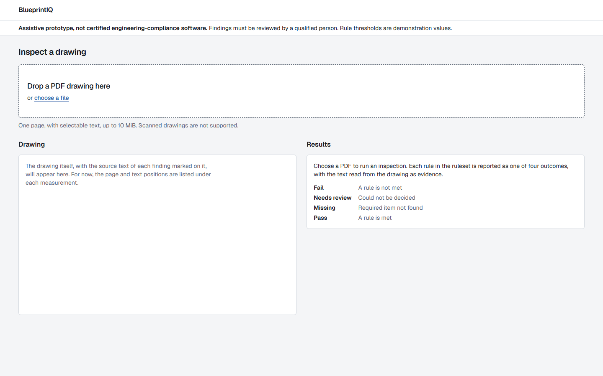 **Empty:** the four outcomes explained before anything is uploaded | 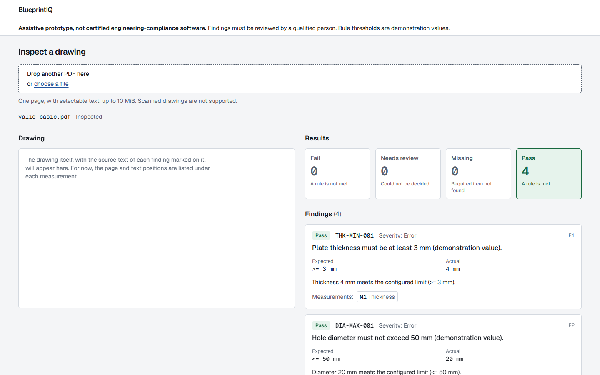 **Pass:** `valid_basic.pdf`, 4 pass |
| 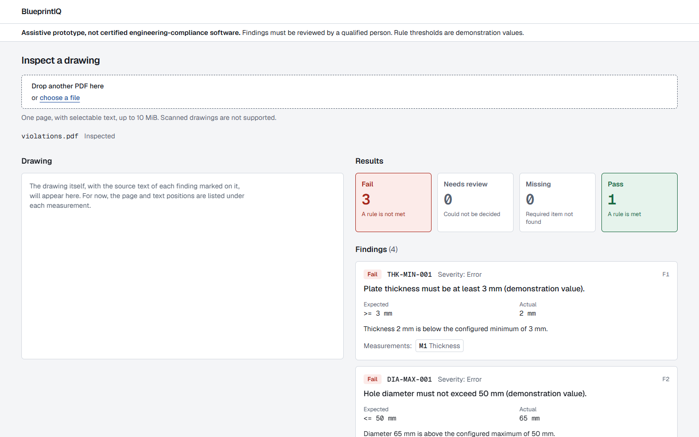 **Fail:** `violations.pdf`, 3 fail and 1 pass | 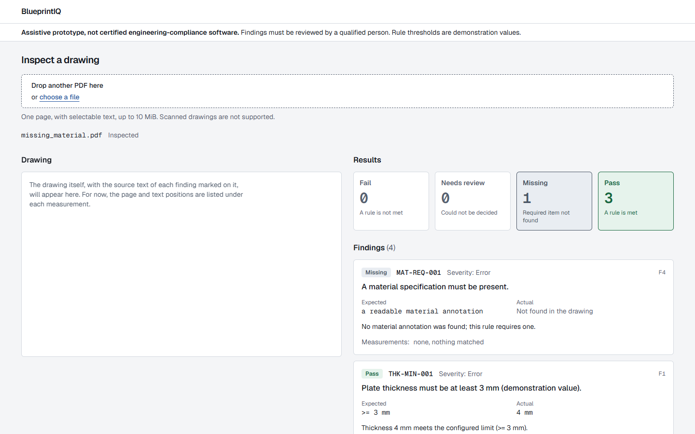 **Missing:** `missing_material.pdf` |
| 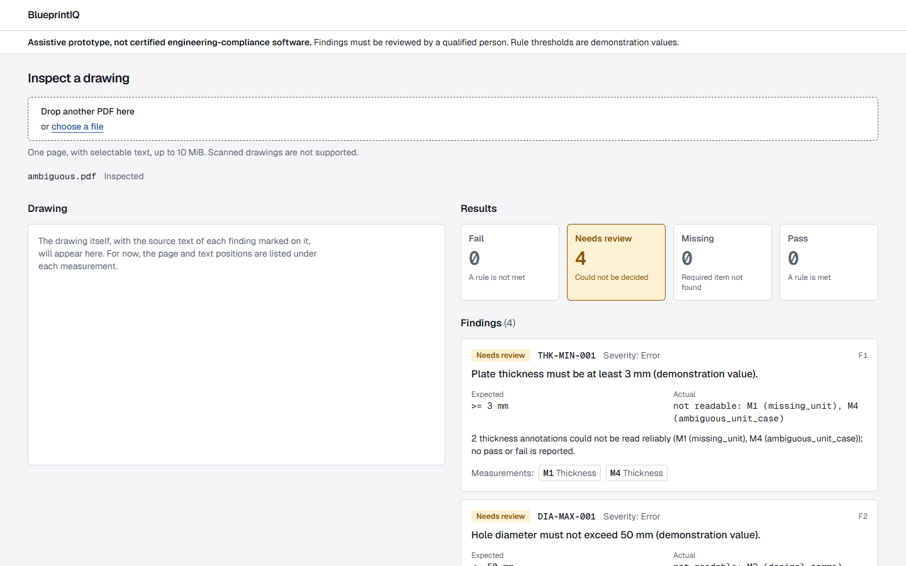 **Needs review:** `ambiguous.pdf` | 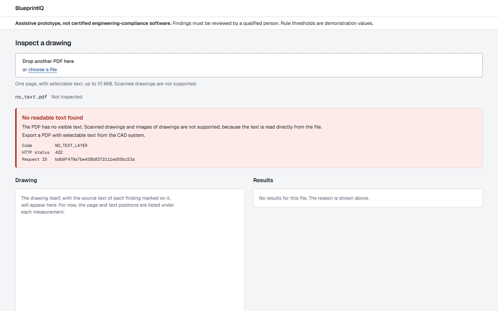 **Refused by the backend:** `no_text.pdf` |
| 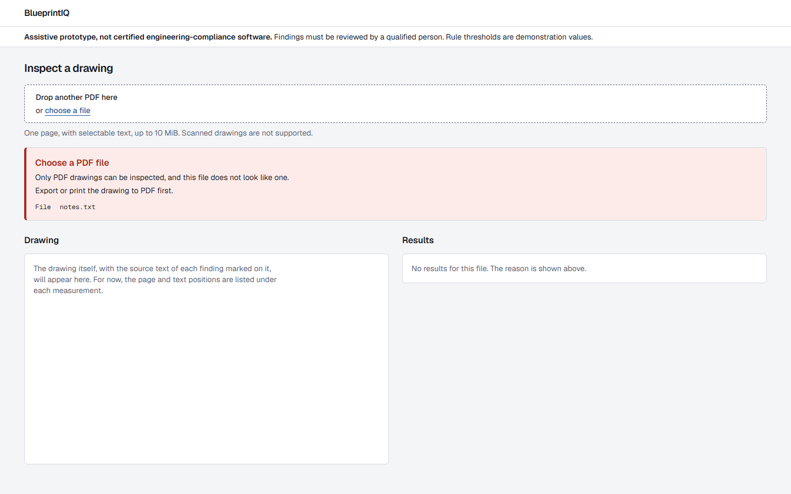 **Refused in the browser:** not a PDF | 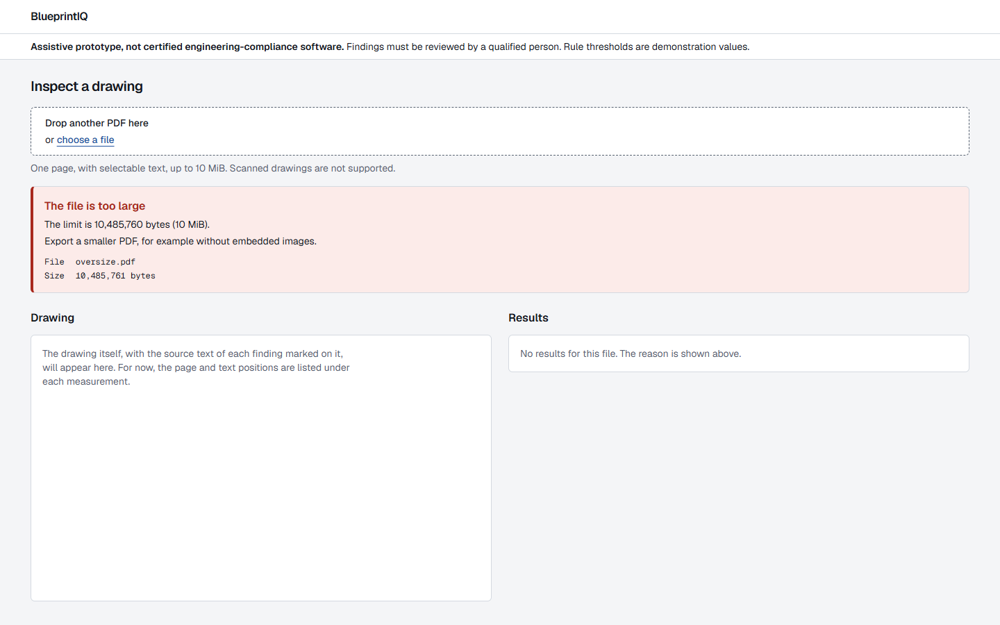 **Refused in the browser:** 10,485,761 bytes |
| 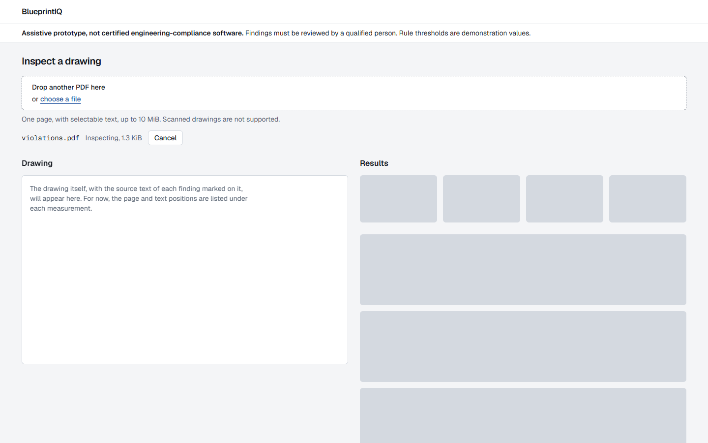 **Loading** (the request was delayed 8 s so the state could be captured) | 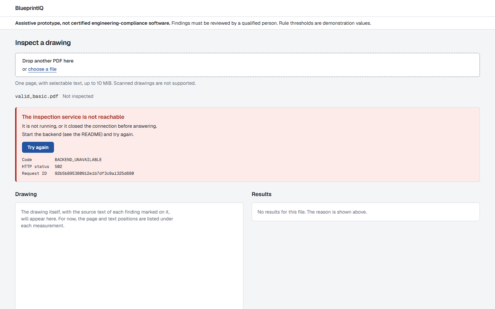 **Backend not running** (the real backend was stopped) |
| 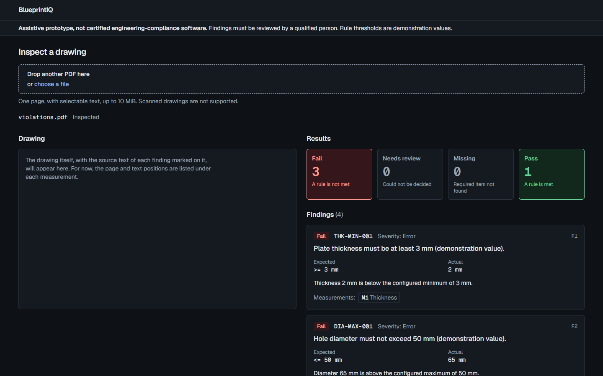 **Dark theme** | 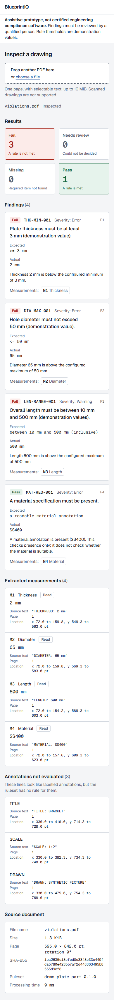 **390 px wide** (full page) |

Also: [full-page desktop result](screenshots/f2-03b-fail-full-page.png), which shows the measurements and the source document panel.

## Component structure

```
src/
  app/
    layout.tsx               fonts, theme-color, SiteHeader on every page
    page.tsx                 <main id="main"> + InspectionDashboard
    globals.css              design tokens (light and dark), shape rule
  api/
    schema.d.ts              GENERATED from backend/openapi.json (npm run api:types)
    types.ts                 aliases for the generated types
    read-response.ts         turns a response into report | error | malformed
    client.ts                the only code that calls fetch; client deadline, abort
  inspection/
    state.ts                 InspectionState and a pure reducer
    use-inspection.ts        owns request lifetime and stale-result protection
    validate-file.ts         type and size checks before upload
    failure-copy.ts          plain-language explanation for every error code
    labels.ts                names for enum values; number and unit formatting
  components/
    site-header.tsx          skip link, wordmark, persistent disclaimer
    inspection-dashboard.tsx the one client container; wires state to parts
    upload-panel.tsx         native file input, drop area, current file, Cancel
    error-panel.tsx          every kind of failure
    results-placeholders.tsx empty state and loading skeleton
    report-view.tsx          a successful result: composes the four below
    summary-cards.tsx        counts per outcome
    findings-list.tsx        structured findings
    measurement-list.tsx     measurements and annotations not evaluated
    document-panel.tsx       source metadata
    viewer-slot.tsx          reserved area for F3 (renders nothing yet)
    status-badge.tsx         finding outcome and extraction status badges
  lib/limits.ts              the 10 MiB limit, shared with the proxy
```

Components are small and take plain props. The only client state is one `useReducer` in `useInspection`; there is no state library, no UI framework, no icon or animation library, and no data fetching library. `package.json` gained no runtime dependency in F2.

## One state describes the whole screen

```
idle | rejected | running | succeeded | failed
```

A result can never appear next to a different file's name or an error, because there is one value and selecting any file replaces it. `rejected` is a file refused in the browser; `failed` is an inspection that was sent but gave no report.

**Stale and repeated requests.** At most one request is current. Choosing another file, choosing an invalid file, pressing Cancel, or leaving the page aborts the current request, and an answer for any request but the current one is dropped by id. The previous result is cleared as soon as a new file is chosen. Choosing the same file twice runs it twice (the input is cleared after each pick).

**Nothing is kept.** The file and the report live in React state only. No `localStorage`, `sessionStorage`, cookies, IndexedDB or server storage; a test checks that nothing is written.

## API integration

* **Only the proxy.** The browser posts to the relative URL `/api/inspections`. No other address is used.
* **Generated types, reproducible.** The backend writes its OpenAPI document to `backend/openapi.json` (`uv run python scripts/export_openapi.py`), and `npm run api:types` turns that file into `src/api/schema.d.ts` with the pinned `openapi-typescript`. Both steps work offline. Drift is caught in two places: a backend test fails if `openapi.json` is stale, and `npm run api:check` (run in CI) fails if `schema.d.ts` does not match `openapi.json`.
* **Decimal quantities stay strings.** The schema already types them as strings, the reader accepts only plain-notation decimal text for them, and nothing converts them to numbers: `4.10` stays `4.10`.
* **Three response types, never mixed.** `read-response.ts` returns exactly one of:
  * `report`: status 200 and a body that passes every check;
  * `error`: a non-2xx status and the backend's error envelope;
  * `malformed`: anything else, including an error body with status 200, a report with an error status, other 2xx and 3xx statuses, non-JSON, truncated JSON, and a report that breaks its own contract.
* **Runtime checks.** The report is rebuilt field by field from the generated types, so a backend schema change is a compile error in the reader instead of silent drift. It checks enum values, id formats, decimal format, non-negative whole-number counts, box corners in order, pages that exist, unique ids, that every finding's references resolve, and that the summary matches the findings. A failure names the path (`findings[0].status`) but never the offending value. Unknown extra fields are ignored.
* **Client deadline.** 130 s, just above the proxy's 120 s, as a safety net if the proxy never answers.

## Error codes

Every code the backend can emit has its own explanation in `failure-copy.ts` (a test reads the backend source and fails if a code is missing one), plus the codes the proxy adds and the browser-side checks. An unknown code is labelled as such and shows what the service said. Retry is offered only when the cause is not the file (service busy, timeouts, unreachable service, an unusable reply). Details (code, HTTP status, request ID) are shown in monospace for support.

## UX decisions

* **Inspection starts when a file is chosen.** There is no separate submit step: nothing leaves the machine except to the local backend, and one fewer click matters when comparing drawings. Cancel is available while it runs.
* **The drop area compacts after the first file**, so the results stay in view.
* **Attention first.** Summary cards and findings are ordered Fail, Needs review, Missing, Pass. Within an outcome the backend's order is kept. The four outcomes are never merged, and each card says what it means ("Could not be decided" is not "Required item not found").
* **Status is text first.** Every outcome is written as a word; colour only reinforces it. Extraction status (`Read` or `Ambiguous`) uses a different, outlined badge, because it is a different concept from a rule outcome.
* **Nothing is invented.** An unread value says "No value read"; a missing finding says "Not found in the drawing" and lists no measurement; an unknown location says "Not available". Converted values are shown only when the unit is not millimetres.
* **Errors are not results.** They get their own panel above the results area; the results area then says there is nothing for this file.
* **Visual language.** A cool-neutral palette, one accent (a drafting blue), four status colours used only for outcomes, Geist and Geist Mono (numbers and identifiers in mono), one 6 px corner radius for panels and controls (4 px for badges), no icons, no decoration, no animation beyond a skeleton pulse that stops under reduced motion. Every text and background pair was measured at WCAG AA (4.5:1) or better in both themes.
* **Persistent disclaimer.** The header, rendered by the root layout on every page and in every state, states that this is not certified engineering-compliance software. It is static text; the report's own `disclaimer` field is validated but not displayed.
* **Reserved viewer area.** `ViewerSlot` is a labelled, sticky panel on wide screens (hidden below 1024 px, where results use the full width). It renders no PDF and no highlights.

## Accessibility

Native `<input type="file">` inside a `<label>` (keyboard, screen reader and click all work; the drop area is an enhancement); a skip link; one `h1`, logical heading order; `aria-describedby` linking the input to the limits; a polite live region announcing progress and completion; `role="alert"` for failures; `aria-busy` on the results while loading; real links for measurement references; visible focus rings (`:focus-visible`); reduced-motion respected; light and dark themes with `color-scheme` and `theme-color`; numbers and units joined with non-breaking spaces. A drop outside the drop area is swallowed so the browser does not navigate away from the page.

The review against the Web Interface Guidelines found, and this change fixed: no skip link, no `theme-color`, units that could wrap away from their numbers, unbalanced headings, and a layout shift when Cancel appeared. Two deliberate deviations: headings and buttons use sentence case, not Title Case; and long lists use `content-visibility: auto` instead of virtualization.

## Loopback binding (a decision, restated)

The supported launch commands are `npm run dev` and `npm run start`, and both bind to `127.0.0.1` (`next dev|start --hostname 127.0.0.1`). **F2 does not add a custom Next.js server.** Next's own default is every network interface, so starting the app any other way (`npx next start`, an IDE run configuration, a container entrypoint) exposes it, and through the proxy the unauthenticated backend.

The proxy's `Host`, `Origin` and `Sec-Fetch-Site` checks defend against web pages (DNS rebinding, cross-site requests). They are **not** a substitute for loopback binding: a program on another machine can send any `Host` it likes. Public deployment remains blocked.

Verified by tests:

* `tests/proxy/launch-scripts.test.ts`: both scripts are `next dev|start --hostname 127.0.0.1`; no script contains `0.0.0.0`, another hostname or `-H`; no custom server file exists; `next.config.ts` sets no address.
* `tests/proxy/launch-binding.test.ts`: starts the real `start` and `dev` arguments and checks that the app accepts connections on `127.0.0.1` and does **not** on `::1` or on any of the machine's other IPv4 addresses (3 found on the development machine). The check is skipped on a machine with no other address. It restores `tsconfig.json`, which `next dev` rewrites.

## Verification: what was and was not checked

| Check | Result |
|---|---|
| ESLint, strict TypeScript, generated types current, production build, production `npm audit` (clean `npm ci`) | pass, 0 production vulnerabilities |
| Unit and component tests (`npm test`): reader, client, file validation, error copy, reducer and hook, every screen state, keyboard, drag and drop | 395 passed (10 files) |
| Real Next.js server (`npm run test:server`): proxy over raw sockets, launch scripts' binding | 24 passed (2 files) |
| **Real backend** (`npm run test:backend`): all 32 fixtures, UI reader and rendering checked against the backend's hand-written ground truth, the whole screen driven by real responses | 180 passed (2 files) |
| Backend gate: `ruff check`, `ruff format --check`, `mypy`, `pytest`, including the new OpenAPI snapshot test | pass; 1,131 passed, 3 skipped (the skips are Windows-only memory-limit tests) |
| By hand: the real production app, real backend, Chromium via the Playwright CLI | the screenshots above |

**What the real-backend tests prove.** For every one of the 32 committed fixtures, the response is read without being called malformed; the 10 refused fixtures give exactly the error code the backend's ground truth lists, and each has its own explanation; for the 22 valid ones the findings (rule, outcome, measurements, in order) equal the hand-written expected findings, the screen shows those outcomes with matching counts, every measurement's source text and decimal appears exactly as sent, and every reference points at a measurement on the page. Across the fixtures all four outcomes, an ambiguous measurement and a rotated page occur. The whole screen is also driven with real responses for a pass, failures, a missing finding, needs review, three refusals, a non-PDF file and a backend that is not running.

**What the mocked tests prove, and do not.** The component tests replace the upload function with a controllable double, so they decide the order of answers. They prove how the screen reacts to each kind of outcome, including stale requests and malformed bodies. They say nothing about real network behaviour; the real-backend suite covers that.

**What no test proves.** The tests run in jsdom, not a browser. Layout, visual focus rings, real drag-and-drop with the operating system, and real file dialogs are not covered by automated tests. By hand, in Chromium: a real file chooser upload, each state in the screenshots, retry after the backend returned, dark mode and a 390 px width. Real drag-and-drop and keyboard-only operation were exercised only with synthetic events (jsdom). There is no browser end-to-end test in CI yet.

## Known limitations and notes

* **Backend wording.** For a "needs review" finding the backend's own `actual` and `message` text can contain raw issue codes such as `missing_unit` or `ambiguous_unit_case`. The app shows the backend's text verbatim (it is evidence) and explains the same issues in plain language under each measurement. Better wording belongs in the backend.
* **Long reports.** Findings and measurements use `content-visibility: auto`, not virtualization. The largest report measured in F1 (about 4.3 MiB, from 5,000 annotation lines) has not been rendered or timed in a browser.
* **File type check is shallow.** The browser checks type and size only. The `%PDF-` signature and all structure are checked by the backend, which is authoritative.
* **Cancel and retry do not cancel backend work**, as documented in [frontend-f1.md](frontend-f1.md).
* **Screenshots are manual.** They were captured by hand and are not regenerated by CI. Full-page captures need `content-visibility` switched off for the capture, because off-screen rows are not painted until scrolled to; the rows render normally in use.
* **One intermittent failure, unexplained.** In one of five full runs of the real-backend project, a single F1 proxy test (`keeps the backend's own check of the decoded file name length`) failed after 19 ms. Its error message was not captured. It passed in the other four full runs, in an isolated run, and in 1,560 stress requests (direct and through the proxy) that exercise the same early-answer path. Cause not identified; if it recurs in CI it needs investigating, not retrying.
* **Single page only**, as the backend, and the F3 viewer will assume one page.
