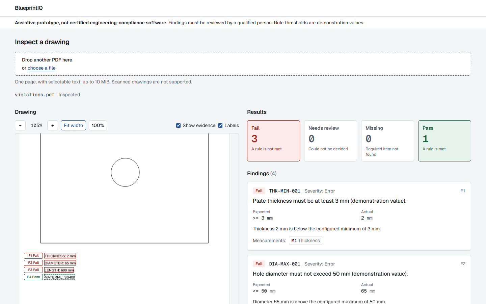
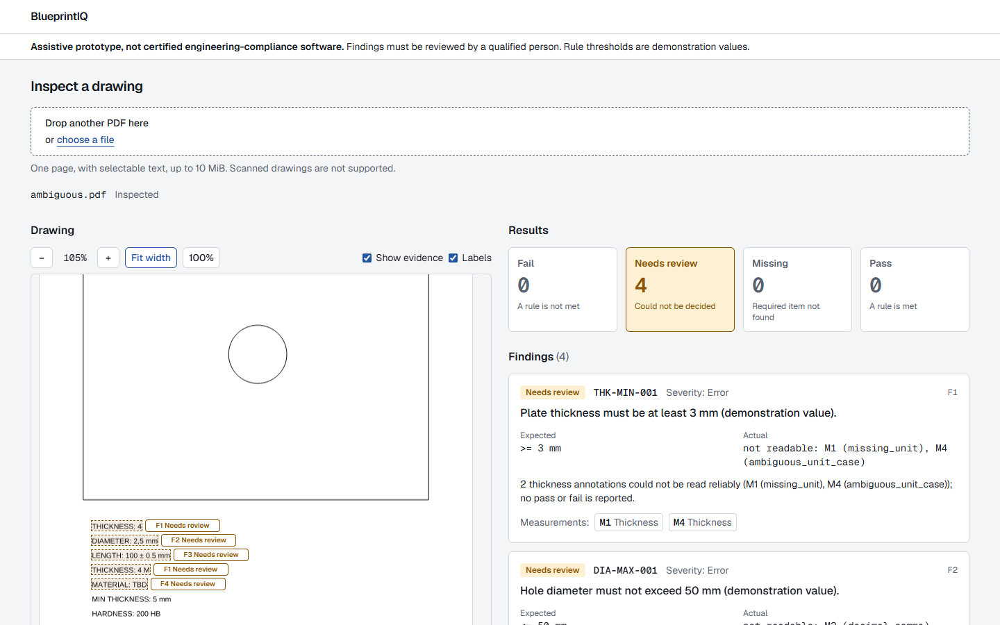
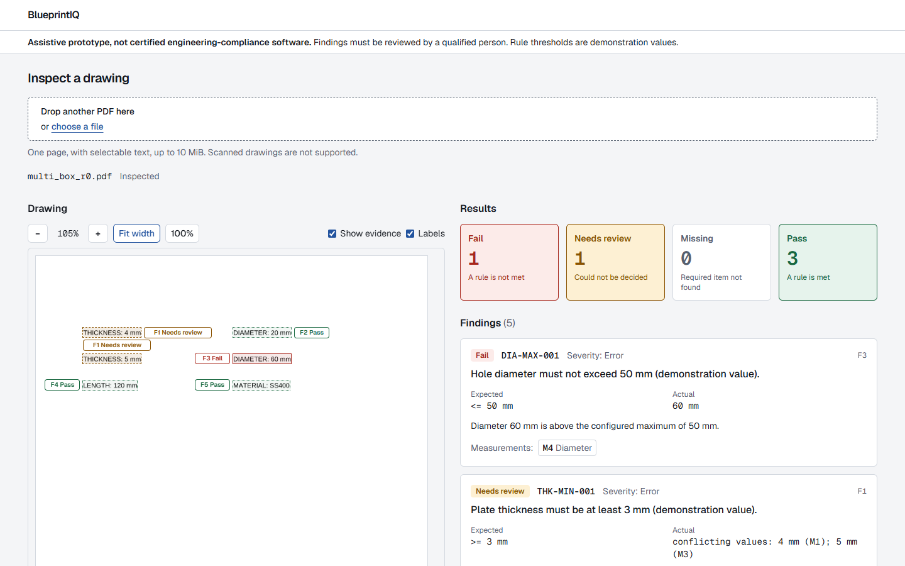
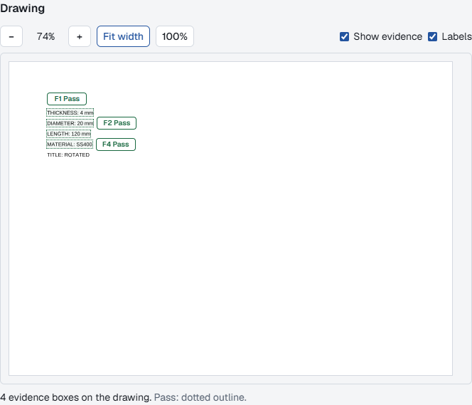
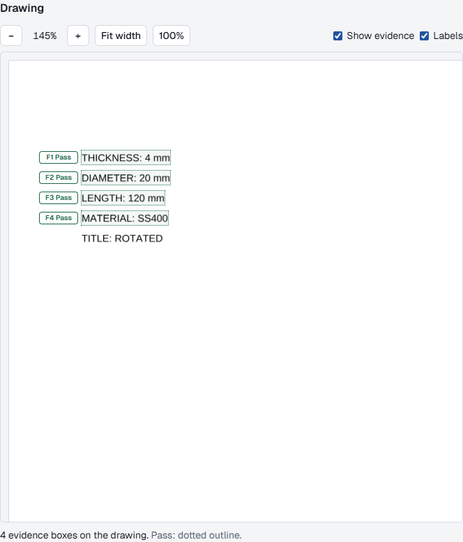
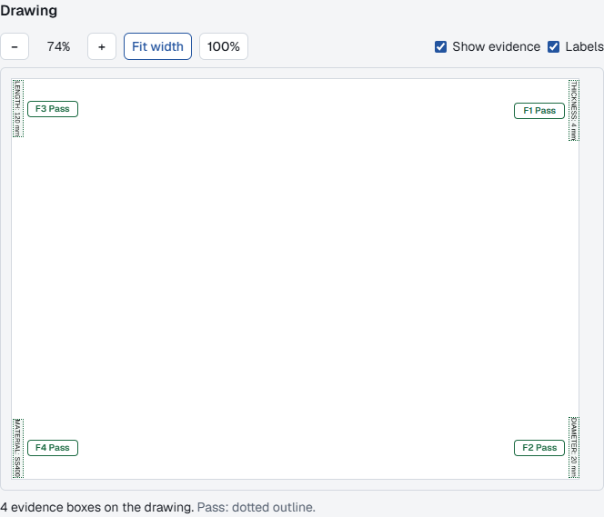
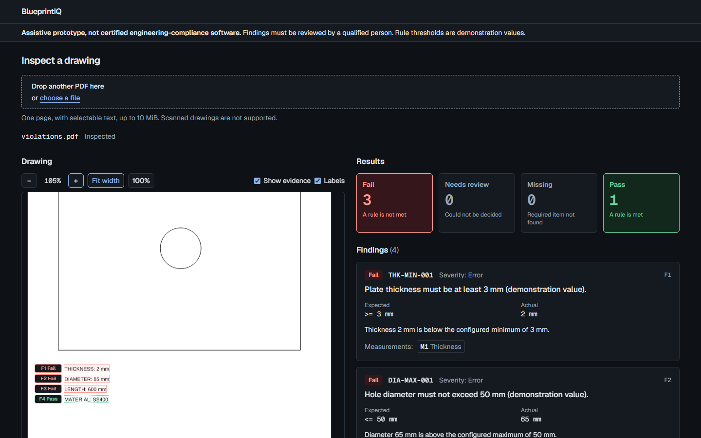
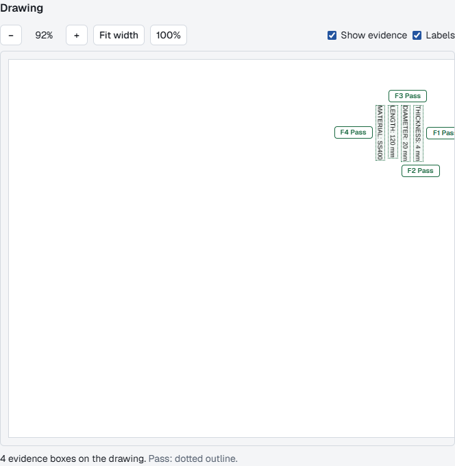
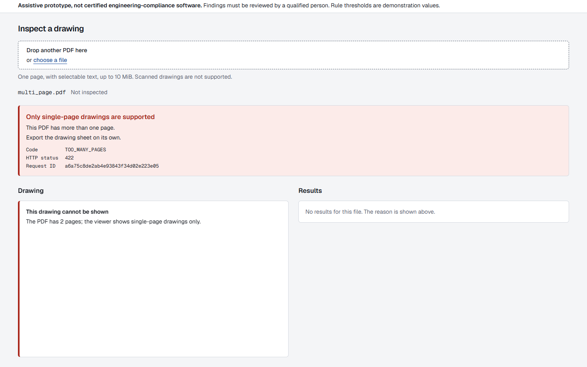

# Frontend F3: PDF.js rendering and evidence overlays

**Scope:** the inspected PDF is rendered in the browser with PDF.js, and the report's evidence boxes are drawn on top of it. **Not in F3:** linking findings to boxes interactively (F4), multi-page documents, and any change to backend inspection logic.

The requirement that drives everything here: **a box must mark the text it claims to mark, or not be drawn at all.** A misleading highlight is worse than none.

**Trusted local use only**, as the rest of Phase 2A. Assistive prototype, not certified engineering-compliance software.

## Screenshots (real app, real backend, synthetic fixtures)

Production build, captured with the Playwright CLI.

| | |
|---|---|
|  `violations.pdf`: three failures (solid outline) and a pass (dotted), each box on its line |  `ambiguous.pdf`: needs review (dashed) |
|  one finding (F1, two conflicting thicknesses) with two boxes, plus a pass and a fail for two holes |  `cropped_rotated_90.pdf`: CropBox offset (50, 40) and /Rotate 90 |
|  `inherited_crop_rotated_270.pdf` at 145%: inherited crop box, /Rotate 270 |  text 3 pt from every edge of a /Rotate 90 page |
|  dark theme (the page itself stays as printed) |  text running vertically on screen: labels go where they cover nothing |
|  a two-page PDF: not shown, no evidence | |

## Architecture

```
src/viewer/
  geometry.ts          pure: page space -> PDF user space -> viewport; page consistency check
  evidence.ts          pure: which boxes of a validated report may be drawn, and why not
  zoom.ts              pure: zoom steps, fit width, canvas size limits, device pixel plan
  pdf-source.ts        the interface the viewer needs from a PDF engine
  pdfjs-source.ts      the PDF.js 6.4.299 implementation (worker from F0)
  use-opened-pdf.ts    one document per file: open, close, discard late results
  use-layout-signals.ts  container width (ResizeObserver), devicePixelRatio
  page-canvas.tsx      render into an off-screen canvas, commit only the newest result
  evidence-overlay.tsx the boxes (non-interactive layer)
  label-placement.ts   pure: where each label goes without covering any box or label
  drawing-viewer.tsx   states, toolbar, identity and geometry checks
src/app/pdfjs-assets/  PDF.js's fonts, CMaps and image decoders, served locally
src/app/viewer-check/  diagnostic page used by the browser tests (like /pdfjs-check)
```

The viewer knows nothing about rules or extraction. It receives the selected `File` and a `ViewerEvidence` built from an already validated report (`buildViewerEvidence`), and draws boxes only if every check below passes.

### Rendering

1. **The local file is rendered.** `File.arrayBuffer()` gives the bytes; they are hashed (SHA-256, Web Crypto) and handed to PDF.js. Nothing is uploaded again and nothing is stored.
2. **One document at a time.** A new file aborts the previous open, closes any document it opened (`PDFDocumentLoadingTask.destroy()`, which also ends its worker), and discards results that arrive late. The state for a file is only read while that same file is selected; anything else reads as "opening". Each document gets a new canvas and new zoom state (React `key`).
3. **No stale bitmaps.** Each render draws into its own off-screen canvas. Only when it finishes, and only if it is still the newest render, is the result copied to the visible canvas; a superseded render is cancelled (`RenderTask.cancel()`), and even one that completes after cancellation cannot draw. Zoom and resize re-render after 120 ms of quiet; meanwhile the existing bitmap is stretched with the layout, so boxes and page move together.
4. **Glyphs as vector outlines** (`disableFontFace: true`), with PDF.js's own standard fonts (`useSystemFonts: false`). Measured: with browser fonts, text that is rotated on screen drifted up to 1.6 pt along the line at some zoom levels (font hinting); as outlines it stays within each glyph's side bearings at every zoom, and renders the same on every operating system.
5. **States:** opening; drawing the page; drawn; render failed (with Try again); unsupported (password-protected, more than one page); failed (not a PDF, unreadable). Boxes are never drawn over a blank or failed canvas.
6. **Canvas limits.** The backing store is capped at 16,777,216 pixels and 16,384 per side (the strictest common browser limits): the device pixel ratio is lowered first, and zoom is limited on very large sheets (A0 stops at about 144%).

## Coordinate conversion

The backend stores boxes in **page space**: the visible area (CropBox clipped to MediaBox) of the **unrotated** page, origin top-left, y down, points (spec section 15.1). The viewer converts in two steps, and the second is PDF.js's own:

```
page space (x, y)          backend BBox
  -> PDF user space        x_pdf = crop.x0 + x,  y_pdf = crop.y1 - y        (geometry.ts pageToPdf)
  -> viewport CSS pixels   PDF.js viewport.transform for the scale drawn   (rotation, scale, view-box offset)
```

All four corners are transformed and the box is their bounding rectangle. The same `layout` (PDF.js viewport) sizes the canvas element and positions the boxes; device pixels appear only in the canvas backing store, never in box positions.

**Worked example** (`cropped_rotated_90.pdf`: CropBox `[50, 40, 645, 882]`, /Rotate 90; the line "THICKNESS: 4 mm", drawn upright for the reader):

| Step | Value |
|---|---|
| Page-space box (ground truth) | x 92.82 to 102.07, y 682.21 to 770 |
| PDF user space | (142.82, 199.79) and (152.07, 112) |
| PDF.js `page.view`, `page.rotate` | `[50, 40, 645, 882]`, 90 (equal to the report's `pdf_crop_box` and `rotation`) |
| Viewport transform at scale 1 | `[0, 1, 1, 0, -40, -50]`, page shown 842 x 595 |
| Box on screen at scale 1 | left 72, top 92.82, right 159.79, bottom 102.07 |
| Same, from the rotation's definition, `(H - y, x) * s` | left 72, top 92.82, right 159.79, bottom 102.07 |
| At scale 1.5 | transform `[0, 1.5, 1.5, 0, -60, -75]`; box left 108, top 139.23, right 239.685, bottom 153.105 |

A 90-degree page turns its unrotated left edge into the top edge, so page-space x becomes screen y and `H - y` becomes screen x; the crop offset (50, 40) cancels out because page space is measured from the crop box. This case is where the backend found that PyMuPDF's matrix drops the crop offset; here PDF.js's transform and the formula agree to floating-point precision.

## When evidence is not drawn

Every condition is required; otherwise the viewer says why, in words.

| Check | Where | If it fails |
|---|---|---|
| The report's `document.sha256` and `size_bytes` equal the shown file's | `drawing-viewer.tsx` | "the file shown is not the document the inspection describes" |
| The browser can compute SHA-256 at all | same | "could not verify that the file shown is the one inspected" |
| PDF.js's `view` equals `pdf_crop_box` (0.01 pt), same `rotate` (normalised), `userUnit` 1, size equal | `geometry.ts checkPageGeometry` | the difference is named, e.g. "rotated 0 degrees, the PDF viewer says 90" |
| The evidence equals its measurement's source (page and box) | `evidence.ts` | the finding is listed as not marked: "its evidence disagrees with the measurement" |
| The box is non-empty and on its page (backend's 1 pt allowance) | `evidence.ts` | "its box is empty" / "lies outside the page" |
| The box has a location at all | `evidence.ts` | "its position is not known" (also every missing finding: "nothing was found to mark") |
| The page has been drawn | `page-canvas.tsx` | no boxes until it is |

The dashboard passes the viewer the file and report of one state value, so choosing another file replaces both at once; while it is being inspected, no boxes are shown.

## Overlays

* One box per evidence reference, so a finding about several measurements has several boxes.
* **Not colour alone:** fail = solid outline, needs review = dashed, missing = double (never seen in practice: a missing finding has no location), pass = dotted; the finding id and outcome are written beside each box; a legend line states the mapping; each box is a list item with a spoken description.
* **Labels never cover evidence.** Each label tries the left, right, top and bottom of its box and takes the first position that stays on the page and overlaps no box (with its outline) and no other label; the most important outcomes choose first. If no side is clear, the box gets no label (it keeps its outline style and spoken description). Lines of evidence can be neighbours above and below (horizontal text) or left and right (text running vertically on screen); both are handled. "Labels" hides them all. Labels can still cover drawing text that is not evidence, since the viewer does not know where that is.
* The layer has `pointer-events: none`: scrolling and controls work through it. Outlines start at the box edge and are drawn outward (1.5 px, 2.5 px when selected), so they never cover the evidence text and the visible frame is at most that much larger than the box. No animation.
* `selectedKey` emphasises one box and dims the others, for F4 to drive. Changing it, or hiding the evidence, does not re-render the page (checked in jsdom and in the browser).

## Verification

### Independent sources

No test maps coordinates forward and back with the code under test. Each compares this code with something it did not produce:

1. **First principles vs PDF.js, every fixture** (`src/viewer/geometry.pdfjs.test.ts`, Vitest, Node). Each of the 22 committed valid fixtures is parsed by real PDF.js. Each hand-written ground-truth box (Adobe font metrics, `backend/tests/fixtures`) is placed with this code and PDF.js's real transform, and compared with the rectangle derived from the definition of /Rotate, at 7 scales from 0.25 to 3.5. Agreement: within 1e-6 px. Breaking the crop offset or the y-flip fails 21 and 154 of these tests.
2. **Ground truth vs rendered pixels** (`tests/e2e/ground-truth.spec.ts`, Playwright, Chromium). The same ground-truth boxes (no backend involved) are drawn by the real viewer, and each is compared with **where PDF.js actually painted ink**, read back from the canvas. 34 fixtures: the 22 committed ones plus 12 generated with the backend's own PDF writer for the missing cases (text 3 pt and 1.5 pt from every edge at 0/90/180/270, a 180 degree page with an offset crop, an inherited crop with a negative origin at 270, a landscape sheet, several boxes for one finding). Each at fit width, 100%, 195%, 80% and after a window resize, at device pixel ratios 1, 2 and 1.5.
3. **Backend evidence vs rendered pixels** (`tests/e2e/app.spec.ts`). The whole path: upload through the dashboard, real backend (PyMuPDF extraction), real proxy, PDF.js. 30 fixtures at fit, zoomed and resized, three pixel ratios; each box is matched to its ground-truth line by text and checked against the ink within the backend's own documented box contract.

Which side of each line is "up" on screen is read from PDF.js's own text matrices (`tests/e2e/text-orientation.ts`), not from this code.

### Tolerances (explicit, from font metrics)

Gaps are measured per side in CSS pixels between the box and the ink. `em` is the font size at the current scale; 1.5 px allows for anti-aliasing and pixel rounding.

| | Ground-truth boxes (AFM) | Backend boxes (PyMuPDF) |
|---|---|---|
| Ink outside the box | at most 1.5 px + 0.03 em | 1.5 px + 0.03 em + 0.5 pt |
| Empty box along the text | at most 1.5 px + 0.12 em (side bearings are under 0.1 em) | + 1.0 pt (backend contract) |
| Empty box on the ascender side | at most 1.5 px + 0.08 em (capitals reach the ascender) | 1.5 px + 0.8 em |
| Empty box on the descender side | at most 1.5 px + 0.30 em (descender 0.207 em, no descenders in the text) | 1.5 px + 0.8 em |

The backend contract (`backend/tests/integration/fixture_data.py`): a line box contains the AFM ink box within 0.5 pt and exceeds it by at most 1.0 pt along the text and 0.5 em across it, because PDF engines use font ascender and descender metrics.

Pixel measurement is used only where text is legible (10 pt text at least 8 px tall, so 80% and above); below that, anti-aliased strokes fall under the ink threshold. Small scales are covered by test 1 without pixels.

**Negative control:** every ground-truth box, moved 3 pt in each of the four directions, must be reported as wrong, and is, for all 34 fixtures. 2 pt shifts were also tried: most are caught, but along the text (where glyph side bearings legitimately leave up to about 1 pt) some are not, so **3 pt (0.3 em at 10 pt) is the sensitivity claimed**.

### Measured alignment (all three pixel ratios)

| | Ground truth: 2,580 box measurements, 34 fixtures | Backend: 1,119 box measurements, 29 fixtures with evidence |
|---|---|---|
| Ink outside the box | median 0.00 pt, max 0.54 pt | median 0.00 pt, max 0.45 pt |
| Empty box along the text | median 0.55 pt, p95 1.00, max 2.02 pt | median 0.60 pt, p95 1.04, max 3.01 pt |
| Empty box, ascender side | median 0.17 pt, p95 0.39, max 0.55 pt | median 3.67 pt, max 4.38 pt |
| Empty box, descender side | median 1.96 pt, p95 2.12, max 2.35 pt | median 2.77 pt, max 3.83 pt |

Read: the ground-truth boxes fit the painted glyphs to font-metric precision (the descender side is Helvetica's 2.07 pt descender; along the text, glyph side bearings). The backend's boxes are taller than the ink, as its contract says (PyMuPDF uses the font's ascender and descender), and never miss ink by more than 0.45 pt. The CI job uploads these measurements as an artifact on every run.

### Independent review

One focused reviewer (a separate agent, read-only) examined coordinate correctness, rotation and crop handling, stale-document overlays, resource cleanup, rendering failures and PDF.js API assumptions, verifying several points with its own probes. It found **nothing Critical or High**; the mapping, the geometry check (it checked PDF.js's worker code for how `view` is formed and that the backend refuses every case where PDF.js silently falls back), the identity check and the render lifecycle were judged correct. Findings and what was done:

| Severity | Finding | Fix | Regression test |
|---|---|---|---|
| Medium | Opaque labels, always placed left or right of a box, covered neighbouring evidence where text runs vertically on screen (verified on `rotated_90_sideways`: labels sat over other boxes and words) | Label placement with collision avoidance (`label-placement.ts`); no label where no side is clear | unit tests; viewer test with tall side-by-side boxes; a browser check on **every** fixture at every zoom step that no label overlaps a box or another label (removing the collision check fails 3 unit and 2 browser tests) |
| Low | The visible outline (offset 1 px, 2 to 3 px wide) extended up to about 4 px beyond the tested box | Outline starts at the box edge, 1.5 px (2.5 px selected) | documented frame size |
| Low | If the same File object came back after another selection, a closed document's state could be reused, and rendering a destroyed page throws synchronously | The document's result is forgotten when its effect is cleaned up; a render that throws is a failed render | viewer tests for both |
| Low | An abort during PDF.js module loading was noticed only after parsing | Check the signal after loading | (wasted work only; no visible effect to test) |
| Low | The file-switch browser test checked "no boxes" before the first report could have arrived | Rewritten: the first file's boxes are shown, the second inspection is held open, and no boxes appear until its own report | the test itself |
| Info | `/viewer-check` crashed on malformed pasted JSON | Shape check, error message | browser test |
| Info | PDF.js reports /Rotate 135 as 0 | Already recorded by a test; the backend refuses such files | |


### Test totals

* Vitest: 670 unit and component tests (`npm test`), including the geometry, evidence, zoom, label and viewer-state tests.
* Playwright (`npm run test:e2e`, real Chromium, production build, real backend): 222 tests, in about 3 minutes.

The viewer's state tests use a fake PDF engine (`tests/ui/fake-pdf.ts`) to control timing (late opens, cancelled renders that still complete, failed renders); they prove state handling, not rendering. Removing each protection in turn (identity check, geometry check, closing late and replaced documents, the newest-render guard, hiding boxes over a blank canvas, the stale-file guard) makes them fail.

## Limitations

* **Single page only.** A multi-page PDF is not shown (the backend refuses it too).
* **Viewer on wide screens only** (1024 px and up), as reserved in F2; below that the results take the full width.
* **Measured on synthetic fixtures** (Helvetica and Courier, horizontal or 90-degree text). Real CAD PDFs, embedded fonts and CJK text are untested; non-embedded CJK fonts use PDF.js's CMaps, served locally.
* **Sensitivity is 3 pt** for a misplaced box (see above); smaller errors along the text can hide in glyph side bearings.
* **Labels in tight clusters** may sit beside the group rather than unmistakably beside their own box, or be left out; F4's linking will make the association explicit.
* **PDF.js reports an invalid /Rotate (e.g. 135) as 0.** The backend refuses such files, so no report with evidence for them exists; recorded by a test so a change in PDF.js is noticed.
* **Font substitution.** Non-embedded standard fonts are drawn with PDF.js's Liberation and Foxit fonts (same advance widths as Helvetica and Courier); glyph shapes differ slightly from Adobe's.
* **`/viewer-check`** is a diagnostic page, included in the build like `/pdfjs-check`; it shows a local file with evidence from pasted JSON and applies the same checks.
* **Cancelling does not stop backend work**, as documented in F1.
