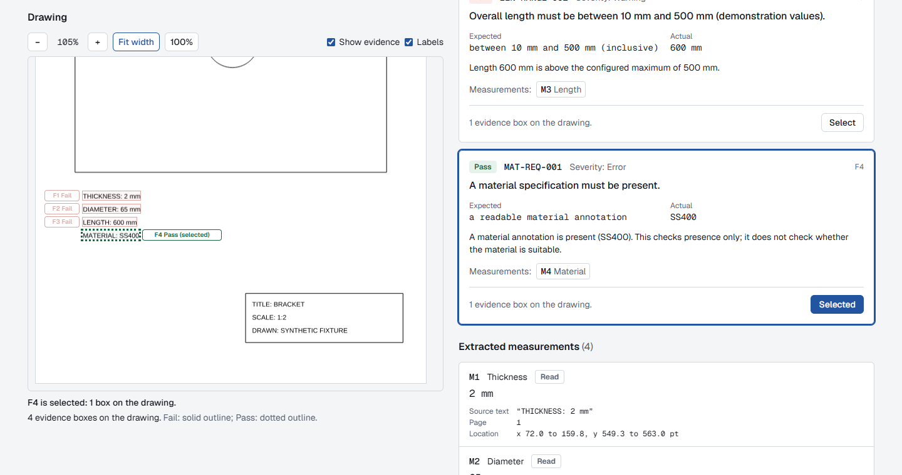
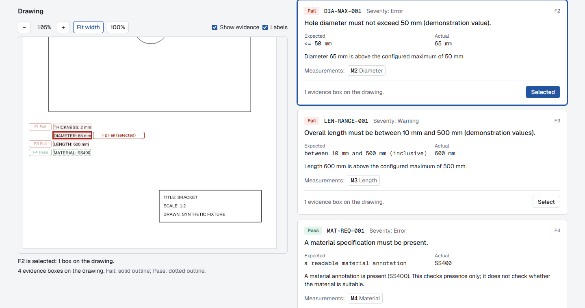
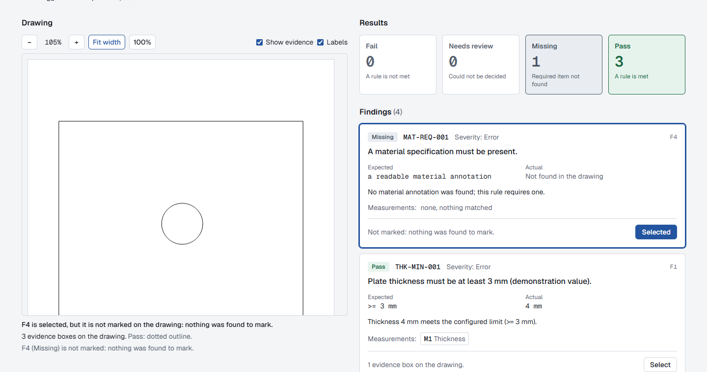

# Frontend F4: interactive evidence linking

**Scope:** selecting a finding shows its evidence on the drawing, and selecting evidence shows its finding. F3's geometry, identity checks and render handling are unchanged. Trusted local use only; assistive prototype, not certified compliance software.

| | |
|---|---|
|  A finding selected in the panel: its box is prominent, the others dimmed, and the viewer says what is selected |  A box clicked in the viewer: its finding is selected in the panel |
|  A finding with no location: selected, explained, nothing highlighted | |

## Behaviour

* **Unit of selection: the finding.** Every box of the selected finding is emphasised (thicker outline, tint, label "(selected)"); all other boxes and labels are dimmed, not hidden. A finding with several boxes highlights all of them.
* **Finding to evidence.** Each finding card has a `Select` button (`aria-pressed`, text changes to `Selected`, accessible name "Select finding F4"); the whole card also selects on click, without taking over its measurement links. Pressing the selected finding again clears the selection.
* **Evidence to finding.** Evidence boxes are real buttons: Tab-reachable, Enter or Space to select, visible focus ring, accessible name "Fail: DIA-MAX-001, finding F4, measurement M3. Select this finding", `aria-pressed`. The boxes are clickable but the layer around them is not, so scrolling and the toolbar still work through it.
* **Overlapping boxes** (for example two findings about the same measurement text). A click chooses the most important finding under the pointer (fail before needs review before pass); clicking again cycles to the next one; clicking when only one is there deselects. Every box is also reachable by Tab, so no finding depends on the mouse. The viewer says so: "Overlaps F1; click the box again to switch."
* **No location.** A finding that has no usable location (missing, an ambiguous measurement without a position, or evidence refused by F3's checks) can still be selected. The card says "Not marked: nothing was found to mark" (or the reason), the viewer says "F2 is selected, but it is not marked on the drawing: ...", and no box is highlighted. Nothing is invented.
* **Scrolling, without surprises.**
  * Selecting from the panel brings the finding's boxes into view in the viewer's own scroll area, only when they are not already fully visible; it never scrolls the page and never moves keyboard focus.
  * Selecting from the viewer scrolls the findings panel to the card only if the card is off screen (`scrollIntoView({ block: "nearest" })`); focus stays on the box.
  * Zooming, resizing and re-selecting the same finding do not scroll.
* **Narrow screens.** The viewer is hidden below 1024 px, as before; findings can still be selected (highlighted card, `Selected`, location line), so the panel works alone.

## State safety

* The selection is stored with the report object it was made on, so a new document gives a new report (or none) and the selection is gone at once. It cannot return with the next report even if finding ids repeat (F1, F2, ...). Tested with jsdom and in the browser.
* The viewer receives only a finding id; F3's file identity (SHA-256 and size), geometry validation, overlay trust checks and render cancellation are untouched. Selection changes only restyle existing boxes: **no render happens** (the render count is asserted unchanged in jsdom and in Chromium).

## Tests (focused)

* `src/components/evidence-linking.test.tsx` (jsdom, 18 tests): finding to evidence, several boxes, toggle, card click, no location (missing, no position), box to finding by click and keyboard with focus kept, panel scroll only when needed, exactly overlapping boxes and cycling, Tab reachability, viewer scroll only when needed and never on zoom or box selection, no render on selection, selection cleared by a new file or a refused file, the panel working without the viewer.
* `tests/e2e/linking.spec.ts` (Chromium, real FastAPI backend, 4 scenarios): finding to box with scroll into view, focus kept and no render; box to finding by mouse and keyboard; no-location explanation; file switch clears selection and does not pre-select the next report's findings.
* F3's viewer tests were updated for the renamed prop (`selectedFindingId`) and the boxes' new button labels.

## Limitations

* Selection is one finding at a time; there is no multi-select or "next evidence" navigation.
* Exactly overlapping boxes are told apart by cycling or Tab, not visually; the viewer describes the overlap in words.
* Scrolling is not animated (so reduced-motion needs no special case), which also means a distant jump is abrupt.
* The panel's `Select` and the box buttons are the keyboard paths; there is no arrow-key navigation between boxes.
